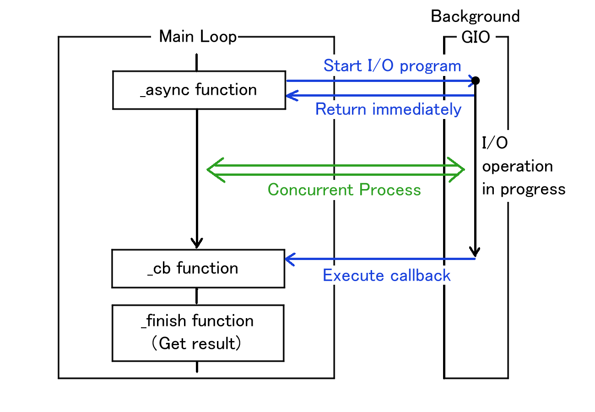

Up: [README.md](../README.md),  Prev: [Section 13](sec13.md), Next: [Section 15](sec15.md)

# File Dialogs and the GIO Asynchronous Model

## What is Asynchronous Operation?

GUI applications, like those built with GTK, run in a continuous loop called the **main loop**.
This loop constantly waits for user events—such as mouse clicks or key presses—and redraws the screen as needed. 

Because the main loop must keep running quickly to keep the application responsive, you should never perform heavy or time-consuming tasks (like reading a large file or downloading data from the network) **directly inside it**. 
If you use a **synchronous** function for a slow I/O operation, the main loop will block and wait for the operation to finish.
During this time, your application will freeze, and the user will not be able to click or type anything.

To solve this problem, we use **asynchronous** operations. 
When you call an asynchronous function, it immediately requests the slow operation to start in the background and instantly returns control to the main loop.
The application remains responsive.
Once the background operation is complete, the application is notified so it can handle the result.

## The GIO Asynchronous Model

GIO is the underlying I/O library used by GTK.
It provides a consistent, powerful model for handling asynchronous operations using a **Callback** mechanism.



The GIO asynchronous model always follows a strict pattern using a pair of functions: `_async` and `_finish`.

1. Start the operation (`_async`):
You call a function ending in `_async` (e.g., `do_something_async`).
You pass your parameters, along with a pointer to a callback function that you have written.
2. Wait in the background:
The `_async` function returns immediately.
The main loop continues running smoothly while GIO does the hard work in the background.
3. Execute the callback:
When the operation completes (either successfully or with an error), GIO automatically calls your callback function.
4. Get the result (`_finish`):
Inside your callback function, you must call the corresponding `_finish` function (e.g., `do_something_finish`).
This function collects the actual result (like a `GFile`) or any `GError` that occurred during the process.

## Getting a File Name with GtkFileDialog

In GTK4, `GtkFileDialog` is the modern way to ask the user to choose a file.
It uses the native file chooser dialog of the user's operating system or desktop environment and is designed entirely around the GIO asynchronous model.

There are two main operations when dealing with files:

- Opening a file: Uses `gtk_file_dialog_open_async` and `gtk_file_dialog_open_finish`.
- Saving a file: Uses `gtk_file_dialog_save_async` and `gtk_file_dialog_save_finish`.

Here is a practical code example of how to show an "Open" file dialog and handle the user's selection using the `_async` and `_finish` pattern.

### The Callback Function

First, we define the callback function that will run when the user selects a file or cancels the dialog.

```C
static void
open_dialog_cb (GObject *source_object, GAsyncResult *res, gpointer data) {
  /* The source_object is the GtkFileDialog that started the operation */
  GtkFileDialog *dialog = GTK_FILE_DIALOG (source_object);
  GError *err = NULL;
  GFile *file;

  /* Call the _finish function to get the result of the async operation */
  /* If an error occurs during the interaction process, the function returns NULL. */
  file = gtk_file_dialog_open_finish (dialog, res, &err);

  if (file != NULL) {
    /* The user selected a file successfully */
    g_print ("File selected: %s\n", g_file_get_path (file));
    
    /* We own the GFile, so we must unreference it when done */
    g_object_unref (file);
  } else {
    /* The user cancelled the dialog or an error occurred */
    g_print ("Dialog cancelled or error: %s\n", err->message);
    g_error_free (err);
  }
}
```

### Setting up and showing the dialog

Next, we write the function that creates the dialog and starts the asynchronous operation.

```C
static void
show_open_dialog (GtkWindow *parent_window) {
  /* Create a new GtkFileDialog instance */
  GtkFileDialog *dialog = gtk_file_dialog_new ();

  /* Start the asynchronous open operation.
   * We pass 'open_dialog_cb' as the callback function. */
  gtk_file_dialog_open_async (dialog, 
                              parent_window, 
                              NULL,           /* GCancellable (NULL means we won't cancel it programmatically) */
                              open_dialog_cb, /* The callback function to run when done */
                              NULL);          /* User data to pass to the callback (NULL here) */
}
```

If you wanted to implement a "Save As" feature instead, the structure would be exactly the same.
You would simply change `gtk_file_dialog_open_async` to `gtk_file_dialog_save_async`, and inside the callback, you would use `gtk_file_dialog_save_finish`.

With this pattern, your application remains fully responsive while the user browses their folders, and you safely receive the selected GFile once they are ready.

Keep in mind that GIO uses this exact same asynchronous pattern for almost all input and output operations, such as reading and writing files.
Therefore, mastering this `_async` and `_finish` pattern is an absolutely essential skill for whenever you write any I/O-related code in the future.

## Clicked Signal Handler on Open Button

Now, we will look at the TFE (Text File Editor) main program `tfeapplication.c`.
First, we will focus on the "clicked" signal handler on "Open" button.
The handler shows the file dialog then reads the file to the newly created TfeTextView instance.

```c
static void
open_cb (GtkNotebook *nb) {
  GtkFileDialog *dialog;
  GtkWidget *win = gtk_widget_get_ancestor (GTK_WIDGET (nb), GTK_TYPE_WINDOW);

  dialog = gtk_file_dialog_new ();
  gtk_file_dialog_open (dialog, GTK_WINDOW (win), NULL, open_dialog_cb, nb);
  g_object_unref (dialog);
}
```

The `open_cb` function is called when the "Open" button is clicked.
It creates a file dialog and calls `gtk_file_dialog_open`, passing `open_dialog_cb` as the callback function.
This starts a background operation that displays the dialog and waits for user input, while the function itself returns immediately to the caller.
Once the user interaction is complete, the background operation invokes the callback.

```c
static void
open_dialog_cb (GObject *source_object, GAsyncResult *res, gpointer data) {
  GtkFileDialog *dialog = GTK_FILE_DIALOG (source_object);
  GtkNotebook *nb = GTK_NOTEBOOK (data);
  GtkWidget *win;
  GFile *file;
  GError *err = NULL;

  if ((file = gtk_file_dialog_open_finish (dialog, res, &err)) == NULL) {
    if (!g_error_matches (err, GTK_DIALOG_ERROR, GTK_DIALOG_ERROR_DISMISSED)) {
      win = gtk_widget_get_ancestor (GTK_WIDGET (nb), GTK_TYPE_WINDOW);
      tfe_error_alert (GTK_WINDOW (win), err);
    }
    g_clear_error (&err);
    return;
  }
  notebook_page_new_with_file (nb, file);
  g_object_unref (file);
}
```

- 9-15: Calls `gtk_file_dialog_open_finish` to retrieve the selected GFile.
A NULL return value indicates that the operation failed or the dialog was dismissed by the user.
If the error was not caused by cancellation, it displays an alert using `tfe_error_alert`.
The function then clears the error and returns.
- 17: Calls `notebook_page_new_with_file` to create a new TfeTextView instance and build a new notebook page with it.
- 18: Frees `file`

The function `tfe_error_alert` is as follows.
This is a private helper function.

```c
static void
tfe_error_alert (GtkWindow *win, GError *err) {
  GtkAlertDialog *alert_dialog;
  GtkWindow *parent;

  if (win != NULL && gtk_widget_get_mapped (GTK_WIDGET (win)))
    parent = win;
  else
    parent = NULL;
  alert_dialog = gtk_alert_dialog_new ("%s", err->message);
  gtk_alert_dialog_show (alert_dialog, parent);
  g_object_unref (alert_dialog);
}
```

- 6-9: The argument `win` can be NULL.
Otherwise it must be the main window instance and also mapped (drawn on the screen).
If it is not mapped, an error possibly occurs even if the window instance actually exists.
- 10: Creates an alert dialog.
- 11: Shows the dialog.
The second argument specifies the "transient parent window."
While passing NULL is generally discouraged, it is mandatory here.
Since `tfe_error_alert` can be called from the "open" handler before the main window is mapped, passing NULL is the only safe way to display the dialog.
See [GTK documentation](https://docs.gtk.org/gtk4/method.Window.set_transient_for.html) for further information about transient parent.
- 12: releases the alert dialog.

### Page build Utility

A private function `notebook_page_new_with_file` creates a new TfeTextView instance and builds a new page in the GtkNotebook.

```c
static void
notebook_page_new_with_file (GtkNotebook *nb, GFile *file) {
  g_return_if_fail (GTK_IS_NOTEBOOK (nb));
  g_return_if_fail (G_IS_FILE (file) || file == NULL);

  GtkWidget *win;
  GtkNotebookPage *nbp;
  GtkWidget *scr;
  GtkWidget *tv;
  GtkWidget *lab;
  int i;
  GError *err = NULL;

  if ((tv = tfe_text_view_new_with_file (file, &err)) == NULL) {
    win = gtk_widget_get_ancestor (GTK_WIDGET (nb), GTK_TYPE_WINDOW);
    tfe_error_alert (GTK_WINDOW (win), err);
    g_clear_error (&err);
    return;
  }
  lab = tfe_label_from_file (file); /* lab is floating. lab can be NULL */
  scr = gtk_scrolled_window_new ();
  gtk_scrolled_window_set_child (GTK_SCROLLED_WINDOW (scr), GTK_WIDGET (tv));
  i = gtk_notebook_append_page (nb, scr, lab);
  nbp = gtk_notebook_get_page (nb, scr);
  g_object_set (nbp, "tab-expand", TRUE, NULL);
  gtk_notebook_set_current_page (nb, i);
}
```

- 14-19: Calls `tfe_text_view_new_with_file` to create a new TfeTextView with the GFile `file`.
The argument `file` can be NULL and the function returns an empty TfeTextView instance.
If an error occurs, it calls `tfe_error_alert` to show the error message and returns.
- 20: Calls `tfe_label_from_file`.
This function creates a GtkLabel instance with the filename obtained from the GFile.
If the argument (GFile) is NULL, the function returns NULL.
-21-22: Creates a scrolled window instance and sets the child to `tv`.
- 23: Appends the scroll window and label to the notebook as the child and tab respectively.
- 24-25: Sets the "tab-expand" property of the notebook page to TRUE using `g_object_set`
- 26: Sets the current page to the new page.

## Clicked Signal Handler on Save Button

Next, we will go on to the "clicked" signal handler on the "Save" button.

```c
static void
save_cb (GtkNotebook *nb) {
  int i;
  GtkWidget *win;
  GtkWidget *scr;
  GtkWidget *tv;
  GError *err = NULL;
  GtkFileDialog *dialog;
  GtkAlertDialog *alert_dialog;

  i = gtk_notebook_get_current_page (nb);
  win = gtk_widget_get_ancestor (GTK_WIDGET (nb), GTK_TYPE_WINDOW);

  if (i == -1) {
    alert_dialog = gtk_alert_dialog_new ("No page to save.");
    gtk_alert_dialog_show (alert_dialog, GTK_WINDOW (win));
    g_object_unref (alert_dialog);
    return;
  }

  scr = gtk_notebook_get_nth_page (nb, i);
  tv = gtk_scrolled_window_get_child (GTK_SCROLLED_WINDOW (scr));

  if (tfe_text_view_get_file (TFE_TEXT_VIEW (tv))) { /* File is already set */
    if (!tfe_text_view_write (TFE_TEXT_VIEW (tv), &err)) {
      tfe_error_alert (GTK_WINDOW (win), err);
      g_clear_error (&err);
    }
  } else {
    dialog = gtk_file_dialog_new ();
    gtk_file_dialog_save (dialog, GTK_WINDOW (win), NULL, save_dialog_cb, tv);
    g_object_unref (dialog);
  }
}
```


- 11-19: If the GtkNotebook has no page, it shows the alert dialog with "No page to save." and returns.
- 24-28: If the TfeTextView holds a GFile, it just writes the content of the buffer to the file.
- 30-32: If the TfeTextView does not hold a GFile, it shows a Filedialog. The callback function is `save_dialog_cb`.

The `save_dialog_cb` function is shown below.

```c
static void
save_dialog_cb (GObject *source_object, GAsyncResult *res, gpointer data) {
  GtkFileDialog *dialog = GTK_FILE_DIALOG (source_object);
  GtkWidget *tv = GTK_WIDGET (data);
  GtkWidget *win;
  GtkWidget *scr;
  GtkWidget *nb;
  GtkWidget *lab;
  GFile *file;
  GError *err = NULL;

  win = gtk_widget_get_ancestor (tv, GTK_TYPE_WINDOW);
  if ((file = gtk_file_dialog_save_finish (dialog, res, &err)) == NULL) {
    if (!g_error_matches (err, GTK_DIALOG_ERROR, GTK_DIALOG_ERROR_DISMISSED)) {
      tfe_error_alert (GTK_WINDOW (win), err);
    }
    g_clear_error (&err);
    return;
  }
  tfe_text_view_set_file (TFE_TEXT_VIEW (tv), file);
  lab = tfe_label_from_file (file); /* lab is floating. lab can be NULL */
  nb = gtk_widget_get_ancestor (tv, GTK_TYPE_NOTEBOOK);
  scr = gtk_widget_get_parent (tv);
  gtk_notebook_set_tab_label (GTK_NOTEBOOK (nb), scr, lab);
  g_object_unref (file);

  if (!tfe_text_view_write (TFE_TEXT_VIEW (tv), &err)) {
    tfe_error_alert (GTK_WINDOW (win), err);
    g_clear_error (&err);
  }
}
```

- 13-19: Calls `gtk_file_dialog_save_finish` to get a GFile.
If the return value is NULL and the user did not cancel the operation (`GTK_DIALOG_ERROR_DISMISSED`), it calls `tfe_error_alert` to show the error dialog.
- 20: Sets the file of `tv` to the GFile that is returned by `gtk_file_dialog_save_finish`.
- 21-25: Sets the tab of the notebook page to the new filename. The Gfile instance is released.
- 27-30: Calls `tfe_text_view_write` to write the content of the buffer to the file.
If an error occurs, it calls `tfe_error_alert` to show the error dialog.
Then, it frees GError.

Up: [README.md](../README.md),  Prev: [Section 13](sec13.md), Next: [Section 15](sec15.md)
