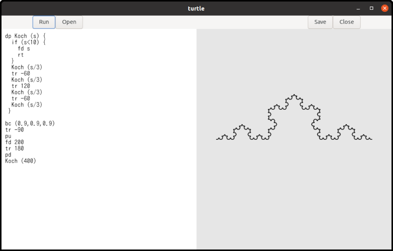

Up: [README.md](../README.md),  Prev: [Section 29](sec29.md), Next: [Section 31](sec31.md)

# Tiny Turtle Graphics Interpreter

The Turtle program is an example that combines TfeTextView and GtkDrawingArea objects.
It is a very small interpreter, but it allows you to draw fractal curves.
The following diagram illustrates a Koch curve, which is a well-known fractal curve.



The following image displays a snowflake curve, which consists of six Koch curves.


The Turtle program uses Flex, a lexical analyzer, and Bison, a parser generator.
These are open-source alternatives to Lex and Yacc, which were proprietary tools developed at Bell Labs.
Because this section focuses mainly on these tools rather than GTK, feel free to skip it.

- [Flex GitHub repository](https://github.com/westes/flex)
- [Flex Documentation](https://westes.github.io/flex/manual/)
- [Bison Project Page](https://www.gnu.org/software/bison/)

## How to Use Turtle

You can find The Turtle documentation [here](turtle/turtle_doc.md).
Here is a simple example.

```
fc (1,0,0) # Foreground color is red, rgb = (1,0,0).
pd         # Pen down.
rp (4) {   # Repeat four times.
  fd 100   # Go forward by 100 pixels.
  tr 90    # Turn right by 90 degrees.
}
```

1. Compile, install, and run `turtle` (See the documentation above for details).
2. Type the program above into the editor on the left pane of the window.
3. Click the `Run` button. A red square with 100-pixel sides will appear on the right pane of the window.

You can draw other shapes and curves using a similar approach.
The Turtle documentation includes examples of fractal curves, such as a tree, a Koch curve, and a square Koch curve.
The source code for these examples is located in the [/src/turtle/example](../src/turtle/example/) directory.
You can load these files into the `turtle` editor by clicking the `Open` button.

## Combining TfeTextView and GtkDrawingArea

Turtle uses TfeTextView and GtkDrawingArea. Here is how they interact:

1. The user types or loads a Turtle program into the TfeTextView buffer.
2. The user clicks the "Run" button.
3. The parser reads the code and generates a data tree.
4. The interpreter executes this data step by step, drawing shapes onto a separate, off-screen surface rather than directly onto the GtkDrawingArea widget.
5. The widget is then queued for a redraw. A drawing function is triggered, which simply copies the off-screen surface onto the GtkDrawingArea.


The core of the interpreter is written using flex and bison.
Because this code is not thread-safe, the `run_cb` callback function---which handles the "clicked" signal for the "Run" button---prevents re-entrancy.

```c
void
run_cb (GtkWidget *btnr) {
  GtkTextBuffer *tb = gtk_text_view_get_buffer (GTK_TEXT_VIEW (tv));
  GtkTextIter start_iter;
  GtkTextIter end_iter;
  char *contents;
  int stat;
  static gboolean busy = FALSE; /* initialized only once */

  /* yyparse() and run() are NOT thread safe. */
  /* The variable busy avoids reentrance. */
  if (busy)
    return;
  busy = TRUE;
  gtk_text_buffer_get_bounds (tb, &start_iter, &end_iter);
  contents = gtk_text_buffer_get_text (tb, &start_iter, &end_iter, FALSE);
  if (surface && contents[0] != '\0') {
    init_flex (contents);
    stat = yyparse ();
    if (stat == 0) { /* No error */
      run ();
    }
    finalize_flex ();
  }
  g_free (contents);
  gtk_widget_queue_draw (GTK_WIDGET (da));
  busy = FALSE;
}

static void
resize_cb (GtkDrawingArea *drawing_area, int width, int height, gpointer user_data) {
  if (surface)
    cairo_surface_destroy (surface);
  surface = cairo_image_surface_create (CAIRO_FORMAT_ARGB32, width, height);
  run_cb (NULL); // NULL is a fake (run button).
}
```

- 8, 12-14: The static variable `busy` tracks the status of the interpreter.
If it is `TRUE`, the interpreter is already running and cannot be called again, as the code is not re-entrant.
If it is `FALSE`, it is safe to call the interpreter, at which point `busy` is set to `TRUE`.
- 15-16: Retrieves the contents of `tb`.
- 17-27: The static variable `surface` points to a `cairo_surface_t` instance.
Because it is created when the GtkDrawingArea is realized and recreated upon resizing, it should always be non-NULL at this stage.
However, as a safety check, if it is `NULL`, the interpreter will not be called.
- 17-24: If `surface` is not `NULL` and `contents` is not an empty string, the interpreter is invoked to perform the following steps:
  - Initializes the lexical analyzer.
  - Calls the parser, which analyzes the program's syntax and generates a data tree.
  - If parsing is successful, it calls the `run` runtime routine.
  - Finalizes the lexical analyzer.
- 25: Frees `contents`.
- 26: Queues the drawing area widget for a redraw.
- 27: Sets `busy` back to `FALSE`.
- 30-36: The "resize" signal handler.
If `surface` is not NULL, it is destroyed.
A new surface is then created to match the dimensions of the GtkDrawingArea, and the `run_cb` callback is called to redraw the shapes.

TfeTextView has been updated to include a "change-file" signal, which is emitted whenever its GFile changes.
For details on how to create and emit signals on an object, please refer to the [GObject Tutorial](https://toshiocp.github.io/Gobject-tutorial/sec4.html).
The updated TfeTextView files (`tfetextview.h` and `tfetextview.c`) are located in the [turtle directory](/src/turtle/).

When the "Open" button is clicked and a file is loaded, the filename is displayed in the header bar.

```c
static void
show_filename (TfeTextView *tv) {
  GFile *file;
  char *filename_bin, *filename_utf;
  char *title;

  /* The instance (TfeTextView) holds the ownership of the returned GFile. */
  file = tfe_text_view_get_file (tv);
  if (G_IS_FILE (file)) {
    filename_bin = g_file_get_basename (file);
    filename_utf = g_filename_display_name (filename_bin);
    title = g_strdup_printf ("Turtle (%s)", filename_utf);
    g_free (filename_bin);
    g_free (filename_utf);
  } else
    title = g_strdup ("Turtle");
  gtk_window_set_title (GTK_WINDOW (win), title);
  g_free (title);
}
```

This is the callback for the "change-file" signal on the TfeTextView instance.

- It calls `tfe_text_view_get_file`.
- If it returns a GFile instance, the title is set to "Turtle (filename)".
- Otherwise, the title defaults to "Turtle".
- Note that `g_file_get_basename` does not necessarily return a UTF-8 string; therefore, the return value must be converted to UTF-8 using `g_filename_display_name`.

The rest of `turtleapplication.c` is very simple and similar to the code in earlier sections.
The complete source code for `turtleapplication.c` can be found in the [turtle directory](/src/turtle/).

## What Does the Interpreter Do?

Suppose the turtle application runs the following program:

~~~
distance = 100
fd distance*2
~~~

The application processes the program as follows:

- Generally, a program consists of tokens.
In the example above, the tokens are "distance", "=", "100", "fd", "*" and "2".
- The parser calls the `yylex` function to read each token from the source file.
`yylex` returns a code representing the "token kind" and sets a global variable, `yylval`, to what is called a semantic value.
The `yylval` variable is a union type.
The types of `yylval.ID` and `yylval.NUM` are string and double, respectively.
Since there are seven tokens in the program, `yylex` is called seven times:

|   |token kind|yylval.ID|yylval.NUM|
|:-:|:--------:|:-------:|:--------:|
| 1 |    ID    |distance |          |
| 2 |    =     |         |          |
| 3 |   NUM    |         |   100    |
| 4 |    FD    |         |          |
| 5 |    ID    |distance |          |
| 6 |    *     |         |          |
| 7 |   NUM    |         |    2     |

- While `yylex` returns a token kind on every call, it does not always set `yylval.ID` or `yylval.NUM`.
This is because keywords (`FD`) and symbols (`=` and `*`) do not have semantic values.
- The `turtle` application then constructs a tree data structure using its internal parser.


- `turtle` analyzes the tree (shown in the image above) and executes it.
This part of the application is called the runtime routine or interpreter.
The tree consists of rectangles and line segments between the rectangles.
The rectangles are called nodes.
For example, `N_PROGRAM`, `N_ASSIGN`, `N_FD`, and `N_MUL` are nodes.
  1. The interpreter goes down from `N_PROGRAM` to `N_ASSIGN`.
  2. The `N_ASSIGN` node has two children, `ID` and `NUM`.
  This node comes from `distance = 100`, which is `ID = NUM` syntactically.
  First, `turtle` checks if the first child is an `ID`.
  If it is, `turtle` looks for the variable in the variable table.
  If it does not exist, it registers the `ID` (`distance`) to the table.
  It then goes back up to the `N_ASSIGN` node.
  3. `turtle` calculates the second child.
  In this case, it is the number `100`.
  It saves `100` to the variable table at the `distance` record.
  4. `turtle` goes back to `N_PROGRAM`, then goes to the next node, `N_FD`.
  This node has only one child.
  The interpreter goes down to the child `N_MUL`.
  5. The first child is an `ID` (`distance`).
  `turtle` searches the variable table for the variable `distance` and gets the value 100.
  The second child is the number 2.
  It multiplies 100 by 2 and gets 200.
  `turtle` then goes back to `N_FD`.
  6. Now `turtle` knows the distance is 200.
  It moves the cursor forward by 200 pixels.
  The segment is drawn on the surface.
  7. There is no following node.
  The runtime routine returns to the function `run_cb`.
- The function `run_cb` calls `gtk_widget_queue_draw` and puts the GtkDrawingArea widget into the queue.
- The system redraws the widget.
At that time, the drawing function `draw_func` is called.
The function copies the `surface` to the surface in the GtkDrawingArea.

An actual `turtle` program is more complicated than the example above.
However, what `turtle` does is basically the same.
Interpretation consists of three parts:

- Lexical analysis
- Syntax parsing and tree generation
- Interpretation and execution of the tree

## Compilation Flow

The source files are:

- flex source file: `turtle.lex`
- bison source file: `turtle.y`
- C header file: `turtle_lex.h`, `tfetextview.h`
- C source file: `turtleapplication.c`, `tfetextview.c`
- Other files: `turtle.ui`, `turtle.gresource.xml`, and `meson.build`

The compilation process involves several steps, as illustrated in the diagram below:

1. `glib-compile-resources` compiles `turtle.ui` into `resources.c` and generates `resources.h`, according to the rules in `turtle.gresource.xml`.
2. `bison` compiles `turtle.y` into `turtle_parser.c` and generates `turtle_parser.h`.
3. `flex` compiles `turtle.lex` into `turtle_lex.c`.
4. The C compiler and linker process `turtleapplication.c`, `tfetextview.c`, `resources.c`, `turtle_parser.c`, and `turtle_lex.c`, alongside their respective headers (`tfetextview.h`, `resources.h`, `turtle_parser.h` and `turtle_lex.h`), to generate the `turtle` executable file.


Meson controls this entire process.
The instructions are defined in `meson.build`:

```
project('turtle', 'c')

compiler = meson.get_compiler('c')
mathdep = compiler.find_library('m', required : true)

gtkdep = dependency('gtk4')

gnome = import('gnome')
resources = gnome.compile_resources('resources','turtle.gresource.xml')

flex = find_program('flex')
bison = find_program('bison')
turtleparser = custom_target('turtleparser', input: 'turtle.y', output: ['turtle_parser.c', 'turtle_parser.h'], command: [bison, '-d', '-o', 'turtle_parser.c', '@INPUT@'])
turtlelexer = custom_target('turtlelexer', input: 'turtle.lex', output: 'turtle_lex.c', command: [flex, '-o', '@OUTPUT@', '@INPUT@'])

sourcefiles=files('turtleapplication.c', 'tfetextview.c')

executable('turtle', sourcefiles, resources, turtleparser, turtlelexer, turtleparser[1], dependencies: [mathdep, gtkdep], export_dynamic: true, install: true)

```

- 1: Defines the project name as "turtle" and the programming language as C.
- 3: Retrieves the C compiler, which is typically `gcc` on Linux.
- 4: Locates the math library.
Because this program uses trigonometric functions, it requires the math library.
While included via `#include <math.h>` in the source code, it must also be explicitly linked during the build process.
- 6: Locates the `gtk4` library dependency.
- 8: Imports the GNOME module.
See the [Meson build system website -- GNOME module](https://mesonbuild.com/Gnome-module.html?utm_source=gemini#gnome-module) for further information.
- 9: Compiles the UI file into a C source file according to the `turtle.gresource.xml` file.
- 11: Locates the `flex` program.
- 12: Locates the `bison` program.
- 13: Uses `bison` to compile `turtle.y` into `turtle_parser.c` and `turtle_parser.h`.
The `custom_target` function creates a custom top-level target.
See the [Meson build system website -- custom target](https://mesonbuild.com/Reference-manual_functions.html?utm_source=gemini#custom_target) for further information.
- 14: Uses `flex` to compile `turtle.lex` into `turtle_lex.c`.
- 16: Creates a file object named `sourcefiles` that contains the C source files.
- 18: Compiles the C source files, including those generated by `glib-compile-resources`, `bison`, and `flex`.
The argument `turtleparser[1]` refers to `turtle_parser.h`, which is the second output defined in line 13.

## Turtle.lex

### What Does Flex Do?

Flex generates a lexical analyzer (also known as a scanner) from a flex source file, which is simply a text file.
(We will explain its syntax later.)
Flex saves the generated scanner as a C source file.
This scanner reads an input text file --- typically programming language source code --- and extracts tokens like variable names, numbers, and symbols.
Consider the following Turtle source file:

```
fc (1,0,0) # Foreground color is red, rgb = (1,0,0).
pd         # Pen down.
distance = 100
angle = 90
fd distance    # Go forward by distance (100) pixels.
tr angle     # Turn right by angle (90) degrees.
```

The content of this text file is broken down into individual units, such as `fc`, `(`, `1`, and so on.

The keywords, identifiers, and numbers --- such as `fc`, `pd`, `distance`, `angle`, `tr`, `1`, `0`, `100`, and `90` --- are called tokens.
The characters `(` (left parenthesis), `,` (comma), `)` (right parenthesis), and `=` (equal sign) are classified as symbols.
(Note that in lexical analysis, these symbols are also generally referred to as tokens.)

Flex reads `turtle.lex` and generates the C source code for the scanner.
This `turtle.lex` file defines the tokens and symbols, along with the specific action to execute when each is encountered.
As you will see, `turtle.lex` is a relatively small and straightforward file.

```lex
%top{
#include <string.h>
#include <stdlib.h>
#include <glib.h>
#include "turtle_parser.h"

  static int nline = 1;
  static int ncolumn = 1;
  static void get_location (char *text);

  /* Dinamically allocated memories are added to the single list. They will be freed in the finalize function. */
  extern GSList *list;
}

%option noyywrap

REAL_NUMBER (0|[1-9][0-9]*)(\.[0-9]+)?
IDENTIFIER [a-zA-Z][a-zA-Z0-9]*
%%
  /* rules */
#.*               ; /* comment. Be careful. Dot symbol (.) matches any character but new line. */
[ ]               ncolumn++; /* white space. [ and ] is a "character class". */
\t                ncolumn += 8; /* assume that a tab is 8 spaces. */
\n                nline++; ncolumn = 1;
  /* reserved keywords */
pu                get_location (yytext); return PU; /* pen up */
pd                get_location (yytext); return PD; /* pen down */
pw                get_location (yytext); return PW; /* pen width = line width */
fd                get_location (yytext); return FD; /* forward */
tr                get_location (yytext); return TR; /* turn right */
tl                get_location (yytext); return TL; /* turn left, since ver 0.5 */
bc                get_location (yytext); return BC; /* background color */
fc                get_location (yytext); return FC; /* foreground color */
dp                get_location (yytext); return DP; /* define procedure */
if                get_location (yytext); return IF; /* if statement */
rt                get_location (yytext); return RT; /* return statement */
rs                get_location (yytext); return RS; /* reset the status */
rp                get_location (yytext); return RP; /* repeat, since ver 0.5 */
  /* constant */
{REAL_NUMBER}     get_location (yytext); yylval.NUM = atof (yytext); return NUM;
  /* identifier */
{IDENTIFIER}      { get_location (yytext); yylval.ID = g_strdup(yytext);
                    list = g_slist_prepend (list, yylval.ID);
                    return ID;
                  }
"=="              get_location (yytext); return EQ; /* equality operator */
"="               get_location (yytext); return '='; /* assignment operator */
">"               get_location (yytext); return '>';
"<"               get_location (yytext); return '<';
"+"               get_location (yytext); return '+';
"-"               get_location (yytext); return '-'; /* subtraction or unary minus */
"*"               get_location (yytext); return '*';
"/"               get_location (yytext); return '/';
"("               get_location (yytext); return '(';
")"               get_location (yytext); return ')';
"{"               get_location (yytext); return '{';
"}"               get_location (yytext); return '}';
","               get_location (yytext); return ',';
.                 ncolumn++;             return YYUNDEF;
%%

static void
get_location (char *text) {
  yylloc.first_line = yylloc.last_line = nline;
  yylloc.first_column = ncolumn;
  yylloc.last_column = (ncolumn += strlen(text)) - 1;
}

static YY_BUFFER_STATE state;

void
init_flex (const char *text) {
  state = yy_scan_string (text);
  nline = ncolumn = 1;
}

void
finalize_flex (void) {
  yy_delete_buffer (state);
}
```

The file consists of three sections separated by `%%` (lines 19 and 60).
These are the definitions, rules, and user code sections.

### Definitions Section

- 1-13: The lines between `%top{` and `}` contain C source code.
This code will be copied directly to the top of the generated C source file.
- 2-3: The program uses the `strlen` (line 66) and `atof` (line 40) functions, which are defined in `string.h` and `stdlib.h`, respectively.
These header files are included here.
- 4: The program uses GLib functions and structures, such as `g_strdup` and `GSList`.
The main GLib header file, `glib.h{}`, is included here.
- 5: The `turtle_parser.h` header file is generated from `turtle.y` by Bison.
It defines constants and variables like `PU` and `yylloc`.
This header is included here so the scanner can use them.
- 7-9: The variables `nline` and `ncolumn` track the current input position.
The `get_location` function is declared here (as a forward declaration) so it can be called before its actual definition on lines 62-67.
- 12: `GSList` is a structure for a singly-linked list.
The `list` variable is defined in `turtle.y`, so it is declared here with the `extern` storage-class specifier.
It serves as the head of the list, which is used to keep track of dynamically allocated memory.
- 15: The `%option noyywrap` directive must be specified when the scanner reads from a single input file.
For more details, refer to the "Generated Scanner" section in the Flex documentation.
- 17-18: `REAL_NUMBER` and `IDENTIFIER` are named definitions.
In Flex, a name must begin with a letter or an underscore, followed by zero or more letters, digits, underscores (`_`), or dashes (`-`).
These names are followed by the regular expressions that define them.
They are used in the rules section, where they automatically expand to their corresponding regular expressions.

### Rules Section

This section is the core of the scanner.
Lexical rules consist of patterns and their corresponding actions.
Patterns are either regular expressions or definitions enclosed in braces.
These definitions must be declared beforehand in the definitions section.
The syntax for writing these regular expressions is detailed in the Flex documentation.

For example, consider the rule on line 40:

- `{REAL_NUMBER}` is the pattern
- `get_location (yytext); yylval.NUM = atof (yytext); return NUM;` is the action.

The `{REAL_NUMBER}` pattern is defined on line 17, so it expands to the regular expression `(0|[1-9][0-9]*)(\.[0-9]+)?`.
This expression matches numeric strings like `0`, `12`, and `1.5`.

When the input stream matches this pattern, the matched text is stored in the `yytext` variable, and the corresponding action is executed.
First, the `get_location` function updates the location variables to track the current position in the text.
Then, the matched string is converted into a double-precision floating-point number using `atof(yytext)` and assigned to `yylval.NUM`.
Finally, the scanner returns `NUM`, a token kind defined in `turtle.y` that represents double-precision numbers.

The scanner generated by Flex contains the `yylex` function.
When `yylex` is called and encounters the input string "123.4", it processes it as follows:

1. The string "123.4" matches the `{REAL_NUMBER}` pattern.
2. The `get_location` function is called, updating the location variable `ncolumn` and setting the tracking coordinates within the `yylloc` structure.
3. The `atof` function converts the string "123.4" into the double value `123.4`.
4. This numeric value is assigned to the variable, `yylval.NUM`.
5. Finally, `yylex` returns the `NUM` token kind to the caller.

As a result, the caller knows the input is a number (`NUM`) and its value is `123.4`.

- 20-59: The rules section.
- 21: Defines a comment as a # followed by any characters except a newline. Because no corresponding action is specified, the matched text is simply ignored.
- 22: Matching a white space just increases `ncolumn` by one.
- 23: A tab character is assumed to equal eight spaces.
- 24: Matching a newline character increases `nline` by one and resets `ncolumn` to 1.
- 26-38: When the scanner matches one of these keywords, it updates the location variables (`ncolumn` and `yylloc`) and returns the corresponding token kind.
- 40: Real number constants.
The action converts the matched text in `yytext` to a double-precision floating-point number, stores it in `yylval.NUM`, and returns `NUM`.
- 42: `IDENTIFIER` is defined on line 18.
An identifier is the name of a variable or procedure, beginning with a letter and followed by zero or more letters or digits.
The location variables are updated, and the identifier string is duplicated using the `g_strdup` function and assigned to `yylval.ID`.
This newly allocated memory is then prepended to `list` (a `GSList`) so it can be automatically freed when `list` is freed (`g_slist_free_full` is called).
Finally, the `ID` token kind is returned.
- 46-58: Symbols.
Each line Updates the location variable and returns the token kind.
For single-character symbols (like `=`, `+`, `-`), the token kind is simply the character itself.
The exception is the two-character equality operator `==`, which returns the `EQ` token kind.
- 59: If the input does not match any of the preceding patterns, it triggers an error.
A special token kind, `YYUNDEF`, is returned.

### User Code Section

This section is simply copied into the generated C source file.

- 62-67: The `get_location` function.
The input location is tracked by `nline` and `ncolumn`.
The parser refers to the variable `yylloc`, which is a C structure with four members: `first_line`, `first_column`, `last_line`, and `last_column`.
These point to the start and end of the current input text.
- 69: `YY_BUFFER_STATE` is a pointer to the input buffer.
Flex defines `YY_BUFFER_STATE` in the generated C file (`turtle_lex.c`).
See "Section 11: Multiple Input Buffers" in the Flex documentation for more information.
- 71-75: The `init_flex` function is called by `run_cb`, which is the "clicked" signal handler for the `Run` button.
It takes one string parameter, which the caller fills with the contents of the GtkTextBuffer.
The `yy_scan_string` function sets this string as the input buffer for the scanner.
The `nline` and `ncolumn` variables are initialized to 1.
- 77-80: The `finalize_flex` function is called after the runtime routine finishes.
It deletes the input buffer.

## Turtle.y

Because `turtle.y` is over 800 lines long, explaining the entire source code is impractical. Instead, I will focus on the key points and omit the less important parts.

### What Does Bison Do?

Bison generates the C source code for a parser from a Bison source file (`turtle.y`).
A parser analyzes the source code according to its defined grammar.
Consider the following Turtle source file:

```
fc (1,0,0) # Foreground color is red, rgb = (1,0,0).
pd         # Pen down.
distance = 100
angle = 90
fd distance    # Go forward by distance (100) pixels.
tr angle     # Turn right by angle (90) degrees.
```

The parser calls `yylex` to get the next token.
Each token consists of its type (the token kind) and its value (the semantic value).
Therefore, each time the parser calls `yylex`, it receives the information shown in the following table:

|   |token kind|yylval.ID|yylval.NUM|
|:-:|:--------:|:-------:|:--------:|
| 1 |    FC    |         |          |
| 2 |    (     |         |          |
| 3 |   NUM    |         |   1.0    |
| 4 |    ,     |         |          |
| 5 |   NUM    |         |   0.0    |
| 6 |    ,     |         |          |
| 7 |   NUM    |         |   0.0    |
| 8 |    )     |         |          |
| 9 |    PD    |         |          |
|10 |    ID    |distance |          |
|11 |    =     |         |          |
|12 |   NUM    |         |  100.0   |
|13 |    ID    |  angle  |          |
|14 |    =     |         |          |
|15 |   NUM    |         |   90.0   |
|16 |    FD    |         |          |
|17 |    ID    |distance |          |
|18 |    TR    |         |          |
|19 |    ID    |  angle  |          |

The Bison source code specifies the grammar rules of the Turtle language. For example, `fc (1,0,0)` is a primary procedure.
A procedure is similar to a void function in C because it does not return a value.
While programmers can define their own custom procedures, built-in commands like `fc` are classified as primary procedures.

This grammar rule is defined in the Bison source code as follows:

```
primary_procedure: FC '(' expression ',' expression ',' expression ')';
expression: ID | NUM;
```

This defines the following rules:

- A `primary_procedure` consists of the `FC` token followed by three expressions enclosed in parentheses and separated by commas.
- An expression can be either an `ID` or a `NUM`.

The notation above is known as BNF (Backus-Naur Form).
Strictly speaking, Bison's syntax is not exactly standard BNF, but the differences are minor.

If the expressions are numbers, the first line expands to:

```
FC '(' NUM ',' NUM ',' NUM ')';
```

The parser analyzes the Turtle source code.
If the input matches the definition above, the parser recognizes it as a primary procedure.

The complete grammar of the Turtle language is detailed in the [Turtle manual](https://toshiocp.github.io/Gtk4-tutorial/turtle_doc.html).
The following is an excerpt from that document:

```
program:
  statement
| program statement
;

statement:
  primary_procedure
| procedure_definition
;

primary_procedure:
  PU
| PD
| PW expression
| FD expression
| TR expression
| TL expression
| BC '(' expression ',' expression ',' expression ')'
| FC '(' expression ',' expression ',' expression ')'
| ID '=' expression
| IF '(' expression ')' '{' primary_procedure_list '}'
| RT
| RS
| RP '(' expression ')' '{' primary_procedure_list '}'
| ID '(' ')'
| ID '(' argument_list ')'
;

procedure_definition:
  DP ID '('  ')' '{' primary_procedure_list '}'
| DP ID '(' parameter_list ')' '{' primary_procedure_list '}'
;

parameter_list:
  ID
| parameter_list ',' ID
;

argument_list:
  expression
| argument_list ',' expression
;

primary_procedure_list:
  primary_procedure
| primary_procedure_list primary_procedure
;

expression:
  expression EQ expression
| expression '>' expression
| expression '<' expression
| expression '+' expression
| expression '-' expression
| expression '*' expression
| expression '/' expression
| '-' expression %prec UMINUS
| '(' expression ')'
| ID
| NUM
;
```

The grammar rule defines a `program` first:

- A `program` is either a single `statement`, or a `program` followed by another `statement`.

Because this definition is recursive, it evaluates as follows:

- `statement` is a program.
- `statement statement` becomes `program statement`, which is a `program`.
- For `statement statement statement`, the first two `statements` reduce to a `program`.
This leaves `program statement`, which is also a `program`.

Ultimately, this recursive logic means that a `program` is simply any continuous sequence of `statements`.

The symbols `program` and `statement` are not tokens because they do not appear directly in the input.
In grammar rules, these are called non-terminal symbols (often abbreviated as `nterm`).

Conversely, tokens are called terminal symbols.
In this context, the word "token" has a broad meaning: it includes both named tokens (like `ID` or `NUM`) and single-character symbols (like `=`) that appear in the input.

Let's analyze the previous Turtle program exactly as Bison does:

|   |token kind|yylval.ID|yylval.NUM|parse                               |S/R|
|:-:|:--------:|:-------:|:--------:|:-----------------------------------|:-:|
| 1 |    FC    |         |          |FC                                  | S |
| 2 |    (     |         |          |FC(                                 | S |
| 3 |   NUM    |         |   1.0    |FC(NUM                              | S |
|   |          |         |          |FC(expression                       | R |
| 4 |    ,     |         |          |FC(expression,                      | S |
| 5 |   NUM    |         |   0.0    |FC(expression,NUM                   | S |
|   |          |         |          |FC(expression,expression            | R |
| 6 |    ,     |         |          |FC(expression,expression,           | S |
| 7 |   NUM    |         |   0.0    |FC(expression,expression,NUM        | S |
|   |          |         |          |FC(expression,expression,expression | R |
| 8 |    )     |         |          |FC(expression,expression,expression)| S |
|   |          |         |          |primary_procedure                   | R |
|   |          |         |          |statement                           | R |
|   |          |         |          |program                             | R |
| 9 |    PD    |         |          |program PD                          | S |
|   |          |         |          |program primary_procedure           | R |
|   |          |         |          |program statement                   | R |
|   |          |         |          |program                             | R |
|10 |    ID    |distance |          |program ID                          | S |
|11 |    =     |         |          |program ID=                         | S |
|12 |   NUM    |         |  100.0   |program ID=NUM                      | S |
|   |          |         |          |program ID=expression               | R |
|   |          |         |          |program primary_procedure           | R |
|   |          |         |          |program statement                   | R |
|   |          |         |          |program                             | R |
|13 |    ID    |  angle  |          |program ID                          | S |
|14 |    =     |         |          |program ID=                         | S |
|15 |   NUM    |         |   90.0   |program ID=NUM                      | S |
|   |          |         |          |program ID=expression               | R |
|   |          |         |          |program primary_procedure           | R |
|   |          |         |          |program statement                   | R |
|   |          |         |          |program                             | R |
|16 |    FD    |         |          |program FD                          | S |
|17 |    ID    |distance |          |program FD ID                       | S |
|   |          |         |          |program FD expression               | R |
|   |          |         |          |program primary_procedure           | R |
|   |          |         |          |program statement                   | R |
|   |          |         |          |program                             | R |
|18 |    TR    |         |          |program TR                          | S |
|19 |    ID    |  angle  |          |program TR ID                       | S |
|   |          |         |          |program TR expression               | R |
|   |          |         |          |program primary_procedure           | R |
|   |          |         |          |program statement                   | R |
|   |          |         |          |program                             | R |

The rightmost column indicates the parser's action: Shift (`S`) or Reduce (`R`).

- A shift operation appends the next input token to the parser's stack.
- A reduce operation substitutes a recognized pattern on the stack with its corresponding non-terminal symbol (`nterm`).

For example, in the fourth row, `NUM` is replaced by `expression`.
This substitution process is a reduce operation.

The parser repeats shift and reduce operations until it reaches the end of the input.
If the final result reduces to a `program`, the entire input is syntactically valid.
Whenever a reduction occurs, the parser executes a corresponding action.
These actions build a syntax tree, which is later analyzed and executed by a runtime routine.

Bison source files are called Bison grammar files.
A grammar file consists of four sections: prologue, declarations, rules, and epilogue.
The format is as follows:

```
%{
prologue
%}
declarations
%%
rules
%%
epilogue
```

### Prologue

The prologue section contains C code that is copied directly into the generated parser file.
The following is an excerpt from `turtle.y`:

```bison
%code top{
  #include <stdarg.h>
  #include <setjmp.h>
  #include <math.h>
  #include <glib.h>
  #include <cairo.h>
  #include "turtle_parser.h"

  /* The following line defines 'debug' so that debug information is printed out during the run time. */
  /* However it makes the program slow. */
  /* If you want to debug on, uncomment the line. */

  /* #define debug 1 */

  extern cairo_surface_t *surface;

  /* error reporting */
  static void yyerror (char const *s) { /* for syntax error */
    g_printerr ("%s from line %d, column %d to line %d, column %d\n",s, yylloc.first_line, yylloc.first_column, yylloc.last_line, yylloc.last_column);
  }
  /* Node type */
  enum {
    N_PU,
    N_PD,
    N_PW,
 ... ... ...
  };
}
```

The directive `%code top` copies its contents to the top of the parser implementation file.
It usually includes `#include` directives, declarations of functions, and definitions of constants.
The function `yyerror` reports a syntax error and is called by the parser.
The node type identifies a node in the tree.

The `%code requires` directive copies its contents into both the generated parser file and the generated header file.
This header file is then included by the Flex scanner and other C source files.

```bison
%code requires {
  int yylex (void);
  int yyparse (void);
  void run (void);

  /* semantic value type */
  typedef struct _node_t node_t;
  struct _node_t {
    int type;
    union {
      struct {
        node_t *child1, *child2, *child3;
      } child;
      char *name;
      double value;
    } content;
  };
}
```

- `yylex` is shared between the parser and the scanner source files.
- `yyparse` and `run` are called by the `run_cb` function in `turtleapplication.c`.
- `node_t` is the semantic value type used for non-terminal symbols (`nterms`).

The generated header file uses these definitions to create `YYSTYPE`, the global semantic value type that accommodates all token and non-terminal value types.
The following is an excerpt from the generated header file:

```C
/* Value type.  */
#if ! defined YYSTYPE && ! defined YYSTYPE_IS_DECLARED
union YYSTYPE
{
  char * ID;                               /* ID  */
  double NUM;                              /* NUM  */
  node_t * program;                        /* program  */
  node_t * statement;                      /* statement  */
  node_t * primary_procedure;              /* primary_procedure  */
  node_t * primary_procedure_list;         /* primary_procedure_list  */
  node_t * procedure_definition;           /* procedure_definition  */
  node_t * parameter_list;                 /* parameter_list  */
  node_t * argument_list;                  /* argument_list  */
  node_t * expression;                     /* expression  */
};
```

Other useful macros and declarations are placed in the `%code` directive.

```
%code {
/* The following macro is convenient to get the member of the node. */
  #define child1(n) (n)->content.child.child1
  #define child2(n) (n)->content.child.child2
  #define child3(n) (n)->content.child.child3
  #define name(n) (n)->content.name
  #define value(n) (n)->content.value

  /* start of nodes */
  static node_t *node_top = NULL;
  /* functions to generate trees */
  static node_t *tree1 (int type, node_t *child1, node_t *child2, node_t *child3);
  static node_t *tree2 (int type, double value);
  static node_t *tree3 (int type, char *name);
}
```

### Bison declarations

The declarations section defines all terminal and non-terminal symbols used in the grammar.
It is also used to specify other parser directives, such as `%locations`, `%define`, `%left`, and `%precedence`.

```
%locations
%define api.value.type union /* YYSTYPE, the type of semantic values, is union of following types */
 /* key words */
%token PU
%token PD
%token PW
%token FD
%token TR
%token TL /* ver 0.5 */
%token BC
%token FC
%token DP
%token IF
%token RT
%token RS
%token RP /* ver 0.5 */
%token EQ /* equality operator added on 2026/08/10 */
 /* constant */
%token <double> NUM
 /* identifier */
%token <char *> ID
 /* non terminal symbol */
%nterm <node_t *> program
%nterm <node_t *> statement
%nterm <node_t *> primary_procedure
%nterm <node_t *> primary_procedure_list
%nterm <node_t *> procedure_definition
%nterm <node_t *> parameter_list
%nterm <node_t *> argument_list
%nterm <node_t *> expression
 /* logical relation symbol */
%left '=' '<' '>'
 /* arithmetic symbol */
%left '+' '-'
%left '*' '/'
%precedence UMINUS /* unary minus */
```

The `%locations` directive inserts a location-tracking structure into the generated header file.
This structure is defined as follows:

```C
typedef struct YYLTYPE YYLTYPE;
struct YYLTYPE
{
  int first_line;
  int first_column;
  int last_line;
  int last_column;
};
```

This type is shared between the scanner and the parser files.
The error-reporting function, `yyerror`, uses it to indicate exactly where a syntax error occurred.

The `%define api.value.type union` directive generates the semantic value type (`YYSTYPE`) by combining the types of all tokens and non-terminals, and inserts it into the generated header file.
This generated code is the `YYSTYPE` excerpt shown in the previous subsection.

The `%token` and `%nterm` directives define terminal tokens and non-terminal symbols, respectively.

```
%token PU
... ...
%token <double> NUM
```

These directives define the tokens `PU` and `NUM`.
The numeric values for these token kinds are defined as enumeration constants in the generated header file:

```
  enum yytokentype
  {
  ... ... ...
    PU = 258,                      /* PU  */
  ... ... ...
    NUM = 269,                     /* NUM  */
  ... ... ...
  };
  typedef enum yytokentype yytoken_kind_t;
```

Additionally, the `<double>` tag ensures that the semantic value for `NUM` is typed as a double in the generated header file:

```
union YYSTYPE
{
  char * ID;                               /* ID  */
  double NUM;                              /* NUM  */
  ... ...
}
```

All non-terminal symbols (`nterms`) share the same semantic value type, `node_t *`.

The `%left` and `%precedence` directives define the precedence and associativity of operators:

```
 /* logical relation symbol */
%left '=' '<' '>'
 /* arithmetic symbol */
%left '+' '-'
%left '*' '/'
%precedence UMINUS /* unary minus */
```

The `%left` directive defines the following symbols as left-associative operators.
If the operator `+` is left-associative, then:

```
A + B + C = (A + B) + C
```

In other words, the leftmost operation is evaluated first.

Conversely, if an operator `*` is right-associative, it will be evaluated from right to left:

```
A * B * C = A * (B * C)
```

The definitions above determine the exact behavior of the parser.
Although addition and multiplication are mathematically associative --- meaning `(A + B) + C and A + (B + C)` yield the same result --- the parser requires a strict evaluation order to build the syntax tree.
Without explicitly specifying left (or right) associativity, the parser will encounter ambiguity and result in a shift/reduce conflict.

The order of the `%left` and `%precedence` directives defines the precedence of the operators.
Operators declared later have a higher precedence than those declared earlier (from lowest to highest).

For example, based on the declarations above:


```
v=w+z*5+7 is the same as v=((w+(z*5))+7)
```

**Note:** The `= `operator in the example above is an assignment.
In the Turtle language, an assignment is not evaluated as an `expression`; instead, it is parsed as a `primary_procedure`.
Conversely, the `==` operator (not `=`) is used as a logical operator within expressions.
This logical equality operator is typically used in conditional expressions, such as in an `if` statement.

### Grammar Rules

The Grammar Rules section defines the syntactic grammar of the language. It is written in a format similar to BNF (Backus-Naur Form):

```
result: components { action };
```

- `result`: A non-terminal symbol (`nterm`).
- `components`: A sequence of tokens and/or non-terminal symbols.
- `action`: C code that is executed whenever the parser reduces the components to the result.
This action block is optional and can be omitted.

The following is a simplified excerpt of the grammar rules from `turtle.y`:

```
program:
  statement { node_top = $$ = $1; }
;
statement:
  primary_procedure
;
primary_procedure:
  FD expression    { $$ = tree1 (N_FD, $2, NULL, NULL); }
;
expression:
  NUM   { $$ = tree2 (N_NUM, $1); }
;
```

- The first rule defines `program` as a `statement`.
Whenever a `statement` is reduced to a `program`, the action `node_top = $$ = $1`; is executed.
- `node_top` is a static variable that points to the top (root) node of the tree.
- The symbol `$$` represents the semantic value of the result (the left-hand side of the rule).
For example, in the first rule, `$$` is the semantic value of program, which is a pointer to a `node_t` structure.
- The symbol `$1` represents the semantic value of the first component on the right-hand side. In the first rule, `$1` is the semantic value of `statement`, which is also a `node_t` pointer.
- The second rule defines `statement` as a `primary_procedure`.
Because no action is specified, the default action (`$$ = $1;`) is executed automatically.
- The third rule defines `primary_procedure` as the token `FD` followed by an `expression`. The action calls the `tree1` function to create a new tree node, and assigns the returned pointer to `$$`. This tree node contains a type identifier and a union (which can hold three child node pointers, a string, or a double).

```
node --+-- type
       +-- union contents
                    +---struct {node_t *child1, *child2, *child3;};
                    +---char *name
                    +---double value
```

- The `tree1` function assigns its four arguments to the node's type, `child1`, `child2`, and `child3` members.
- The final rule defines an `expression` as a `NUM` token.
- The action for this rule calls `tree2` to create a tree node.
The parameters for `tree2` are the node type and the numeric semantic value (passed via `$1`).

Suppose the parser reads the following program:

```
fd 100
```

How does the parser process this?

1. The parser reads the `FD` token.
It recognizes that this might be the start of a `primary_procedure`, but it needs to read the next token (the lookahead) to be sure.
2. The scanner (`yylex`) returns the `NUM` token and sets its semantic value (`yylval.NUM`) to the double `100.0`.
The parser then reduces `NUM` to an `expression`.
During this reduction, it creates a new tree node of type `N_NUM` holding the value `100.0`, and sets the `expression`'s semantic value to point to this new node.
3. The parser's stack now contains `FD` followed by `expression`.
The parser reduces these two symbols to a `primary_procedure`.
It creates a new node of type `N_FD` and sets its `child1` member to point to the `N_NUM` node.
The semantic value of the `primary_procedure` is set to point to this new `N_FD` node.
4. The parser reduces `primary_procedure` to statement.
The semantic value of statement simply copies the pointer from `primary_procedure`, so it also points to the `N_FD` node.
5. The parser reduces `statemen`t to `program`.
The semantic value of `statement` is assigned to both the semantic value of `program` and the static variable `node_top`.
6. Finally, `node_top` points to the root `N_FD` node, and the `N_FD` node points to the child `N_NUM` node, successfully building the syntax tree.


The following grammar rules are excerpted from `turtle.y`.
Because these rules are based on the principles explained above, they are presented here without line-by-line explanations.
Please review the code carefully to understand how the remaining rules and actions are structured.

```bison
program:
  statement { node_top = $$ = $1; }
| program statement {
        node_top = $$ = tree1 (N_program, $1, $2, NULL);
#ifdef debug
if (node_top == NULL) g_printerr ("program: node_top is NULL.\n"); else g_printerr ("program: node_top is NOT NULL.\n");
#endif
        }
;

statement:
  primary_procedure
| procedure_definition
;

primary_procedure:
  PU    { $$ = tree1 (N_PU, NULL, NULL, NULL); }
| PD    { $$ = tree1 (N_PD, NULL, NULL, NULL); }
| PW expression    { $$ = tree1 (N_PW, $2, NULL, NULL); }
| FD expression    { $$ = tree1 (N_FD, $2, NULL, NULL); }
| TR expression    { $$ = tree1 (N_TR, $2, NULL, NULL); }
| TL expression    { $$ = tree1 (N_TL, $2, NULL, NULL); } /* ver 0.5 */
| BC '(' expression ',' expression ',' expression ')' { $$ = tree1 (N_BC, $3, $5, $7); }
| FC '(' expression ',' expression ',' expression ')' { $$ = tree1 (N_FC, $3, $5, $7); }
 /* assignment */
| ID '=' expression   { $$ = tree1 (N_ASSIGN, tree3 (N_ID, $1), $3, NULL); }
 /* control flow */
| IF '(' expression ')' '{' primary_procedure_list '}' { $$ = tree1 (N_IF, $3, $6, NULL); }
| RT    { $$ = tree1 (N_RT, NULL, NULL, NULL); }
| RS    { $$ = tree1 (N_RS, NULL, NULL, NULL); }
| RP '(' expression ')' '{' primary_procedure_list '}'    { $$ = tree1 (N_RP, $3, $6, NULL); }
 /* user defined procedure call */
| ID '(' ')'  { $$ = tree1 (N_procedure_call, tree3 (N_ID, $1), NULL, NULL); }
| ID '(' argument_list ')'  { $$ = tree1 (N_procedure_call, tree3 (N_ID, $1), $3, NULL); }
;

procedure_definition:
  DP ID '('  ')' '{' primary_procedure_list '}'  {
         $$ = tree1 (N_procedure_definition, tree3 (N_ID, $2), NULL, $6);
        }
| DP ID '(' parameter_list ')' '{' primary_procedure_list '}'  {
         $$ = tree1 (N_procedure_definition, tree3 (N_ID, $2), $4, $7);
        }
;

parameter_list:
  ID { $$ = tree3 (N_ID, $1); }
| parameter_list ',' ID  { $$ = tree1 (N_parameter_list, $1, tree3 (N_ID, $3), NULL); }
;

argument_list:
  expression
| argument_list ',' expression { $$ = tree1 (N_argument_list, $1, $3, NULL); }
;

primary_procedure_list:
  primary_procedure
| primary_procedure_list primary_procedure {
         $$ = tree1 (N_primary_procedure_list, $1, $2, NULL);
        }
;

expression:
  expression EQ expression { $$ = tree1 (N_EQ, $1, $3, NULL); }
| expression '>' expression { $$ = tree1 (N_GT, $1, $3, NULL); }
| expression '<' expression { $$ = tree1 (N_LT, $1, $3, NULL); }
| expression '+' expression { $$ = tree1 (N_ADD, $1, $3, NULL); }
| expression '-' expression { $$ = tree1 (N_SUB, $1, $3, NULL); }
| expression '*' expression { $$ = tree1 (N_MUL, $1, $3, NULL); }
| expression '/' expression { $$ = tree1 (N_DIV, $1, $3, NULL); }
| '-' expression %prec UMINUS { $$ = tree1 (N_UMINUS, $2, NULL, NULL); }
| '(' expression ')' { $$ = $2; }
| ID    { $$ = tree3 (N_ID, $1); }
| NUM   { $$ = tree2 (N_NUM, $1); }
;
```

### Epilogue

The epilogue is written in C and is copied directly into the generated parser implementation file.
While you can generally include any arbitrary C code in this section, the Turtle interpreter uses it to contain the runtime routines and other auxiliary functions.

#### Tree Node Creation Functions

The parser uses three functions to create abstract syntax tree nodes: `tree1`, `tree2`, and `tree3`.

- `tree1` creates a node and sets its type, along with pointers to up to three child nodes (`NULL` is permitted).
- `tree2` creates a node and sets its type, along with a numeric value (`double`).
- `tree3` creates a node and sets its type, along with a string pointer.

Each function dynamically allocates memory for the new node.
These allocations are tracked in a list so they can be safely freed when the runtime routine finishes.

These functions are called directly within the semantic actions of the grammar rules section.

```C
/* Dynamically allocated memories are added to the single list. They will be freed in the finalize function. */
GSList *list = NULL;

node_t *
tree1 (int type, node_t *child1, node_t *child2, node_t *child3) {
  node_t *new_node;

  list = g_slist_prepend (list, g_malloc (sizeof (node_t)));
  new_node = (node_t *) list->data;
  new_node->type = type;
  child1(new_node) = child1;
  child2(new_node) = child2;
  child3(new_node) = child3;
  return new_node;
}

node_t *
tree2 (int type, double value) {
  node_t *new_node;

  list = g_slist_prepend (list, g_malloc (sizeof (node_t)));
  new_node = (node_t *) list->data;
  new_node->type = type;
  value(new_node) = value;
  return new_node;
}

node_t *
tree3 (int type, char *name) {
  node_t *new_node;

  list = g_slist_prepend (list, g_malloc (sizeof (node_t)));
  new_node = (node_t *) list->data;
  new_node->type = type;
  name(new_node) = name;
  return new_node;
}
```

#### Symbol Table

Variables and user-defined procedures are registered in the symbol table.
Currently, this table is implemented as a simple C array.
In a future version, it should be replaced with a more efficient data structure, such as a hash table.

- Variables are registered with their name and value.
- Procedures are registered with their name and a pointer to the procedure node.

To support this, each entry in the table contains the following fields:

- type: Identifies whether the entry is a variable or a procedure.
- name: The identifier string.
- value: Either a numeric value (for variables) or a node pointer (for procedures).

```C
#define MAX_TABLE_SIZE 100
enum {
  PROC,
  VAR
};

struct {
  int type;
  char *name;
  union {
    node_t *node;
    double value;
  } object;
} table[MAX_TABLE_SIZE];
int tp;

void
init_table (void) {
  tp = 0;
}
```

The `init_table` function initializes the symbol table.
This function must be called before registering any entries.

There are five functions used to access the table:

- `proc_install` installs a procedure.
- `var_install` installs a variable.
- `proc_lookup` searches for a procedure.
If found, it returns a pointer to the procedure node; otherwise, it returns `NULL`.
- `var_lookup` searches for a variable.
If found, it returns `TRUE` and assigns the value to the provided pointer argument; otherwise, it returns `FALSE`.
- `var_replace` updates the value of a variable.
If the variable has not been registered yet, this function installs it.

```C
int
tbl_lookup (int type, char *name) {
  int i;

  if (tp == 0)
    return -1;
  for (i=0; i<tp; ++i)
    if (type == table[i].type && strcmp(name, table[i].name) == 0)
      return i;
  return -1;
}

void
tbl_install (int type, char *name, node_t *node, double value) {
  if (tp >= MAX_TABLE_SIZE)
    runtime_error ("Symbol table overflow.\n");
  else if (tbl_lookup (type, name) >= 0)
    runtime_error ("Name %s is already registered.\n", name);
  else {
    table[tp].type = type;
    table[tp].name = name;
    if (type == PROC)
      table[tp++].object.node = node;
    else
      table[tp++].object.value = value;
  }
}

void
proc_install (char *name, node_t *node) {
  tbl_install (PROC, name, node, 0.0);
}

void
var_install (char *name, double value) {
  tbl_install (VAR, name, NULL, value);
}

void
var_replace (char *name, double value) {
  int i;
  if ((i = tbl_lookup (VAR, name)) >= 0)
    table[i].object.value = value;
  else
    var_install (name, value);
}

node_t *
proc_lookup (char *name) {
  int i;
  if ((i = tbl_lookup (PROC, name)) < 0)
    return NULL;
  else
    return table[i].object.node;
}

gboolean
var_lookup (char *name, double *value) {
  int i;
  if ((i = tbl_lookup (VAR, name)) < 0)
    return FALSE;
  else {
    *value = table[i].object.value;
    return TRUE;
  }
}
```

#### Stack for Parameters and Arguments

A stack is a last-in, first-out (LIFO) data structure.
Turtle uses a stack to store parameters and arguments whenever a procedure is called.
This LIFO structure is essential for supporting recursive calls.

Each element on the stack contains a name and a value.

```C
#define MAX_STACK_SIZE 500
struct {
  char *name;
  double value;
} stack[MAX_STACK_SIZE];
int sp, sp_biggest;

void
init_stack (void) {
  sp = sp_biggest = 0;
}
```

The `sp` variable serves as the stack pointer.
It is an index for the `stack` array that always points to the next available position to store data.

The `sp_biggest` variable tracks the highest value reached by `sp`.
This allows us to determine the maximum number of elements used in the array at runtime.
Its primary purpose is to help find an appropriate value for `MAX_STACK_SIZE`.
This variable will become unnecessary in a future version if the stack is updated to use a better data structure and dynamic memory allocation.

The runtime routine pushes data onto the stack whenever it executes a procedure call node (type `N_procedure_call`).

For example:

```
dp drawline (angle, distance) { ... ... ... }
drawline (90, 100)
```

- The first line defines the procedure `drawline`.
The runtime routine stores the name "drawline" and its corresponding procedure node in the symbol table.
- The second line calls the procedure.
First, it looks up the procedure in the symbol table to retrieve its node.
Then, it examines the node to retrieve the parameter names, angle and distance.
- Next, it pushes ("angle", `90.0`) onto the stack.
- Then, it pushes ("distance", `100.0`) onto the stack.
- Finally, it pushes (NULL, `2.0`) onto the stack.
The number `2.0` represents the total parameter count.
This count is used to properly clean up (pop) the arguments off the stack when the procedure returns.

The following diagram illustrates the structure of the stack during a series of nested procedure calls.
First, `procedure 1` is called, which takes two parameters.
Inside `procedure 1`, `procedure 2` is called with a single parameter.
Finally, inside `procedure 2`, `procedure 3` is called with three parameters.
Notice how each procedure's block ends with a `NULL` entry storing its total parameter count.

In this implementation, data is pushed onto the stack from lower memory addresses to higher memory addresses.
Therefore, in the diagram, the addresses increase from top to bottom.

However, standard stack terminology can be slightly counterintuitive here.
The "top of the stack" always refers to the most recently pushed data, while the "bottom of the stack" is the very first item pushed.
As a result, the logical "top of the stack" is visually located at the bottom of the diagram, while the logical "bottom of the stack" is at the top.


There are four functions used to access and manage the stack:

- `stack_push` pushes data onto the stack.
- `stack_lookup` searches the stack for a variable by its name.
It restricts this search to the parameters of the most recently called procedure.
If the variable is found, it returns `TRUE` and assigns the value to the provided `value` pointer argument; otherwise, it returns `FALSE`.
- `stack_replace` updates the value of a variable currently on the stack. It returns `TRUE` upon success, or `FALSE` if the variable is not found.
- `stack_return` discards the parameters from the most recent procedure call.
The stack pointer is restored to its previous position, pointing back to the parameters of the calling procedure.
- `stack_search` is an internal helper for lookup and replace.

```C
void
stack_push (char *name, double value) {
  if (sp >= MAX_STACK_SIZE)
    runtime_error ("Stack overflow.\n");
  else {
    stack[sp].name = name;
    stack[sp++].value = value;
    sp_biggest = sp > sp_biggest ? sp : sp_biggest;
  }
}

int
stack_search (char *name) {
  int depth, i;

  if (sp == 0)
    return -1;
  depth = (int) stack[sp-1].value;
  if (depth + 1 > sp) /* something strange */
    runtime_error ("Stack error.\n");
  for (i=0; i<depth; ++i)
    if (strcmp(name, stack[sp-(i+2)].name) == 0) {
      return sp-(i+2);
    }
  return -1;
}

gboolean
stack_lookup (char *name, double *value) {
  int i;

  if ((i = stack_search (name)) < 0)
    return FALSE;
  else {
    *value = stack[i].value;
    return TRUE;
  }
}

gboolean
stack_replace (char *name, double value) {
  int i;

  if ((i = stack_search (name)) < 0)
    return FALSE;
  else {
    stack[i].value = value;
    return TRUE;
  }
}

void
stack_return(void) {
  int depth;

  if (sp <= 0)
    return;
  depth = (int) stack[sp-1].value;
  if (depth + 1 > sp) /* something strange */
    runtime_error ("Stack error.\n");
  sp -= depth + 1;
}
```

#### Surface and Cairo

The global variable `surface` is shared between `turtleapplication.c` and `turtle.y`.
It is initialized in `turtleapplication.c`.

The runtime routine uses its own Cairo context, which is distinct from the context used by the GtkDrawingArea instance.
The runtime routine uses this context to draw shapes directly onto `surface`.

After the runtime routine returns to `run_cb`, `run_cb` queues the GtkDrawingArea widget for a redraw.
When the widget is redrawn, the `draw_func` function is called to copy the contents of `surface` onto the surface of the GtkDrawingArea object.

The `turtle.y` file contains two functions to manage the Cairo context:

- `init_cairo` initializes the Cairo context and the static variables that track the pen status (up or down), direction, initial location, line width, and color.
`init_cairo` first retrieves the current dimensions of the surface to set the turtle's initial location (at the center of the surface) and configure the transformation matrix (see below).
- `destroy_cairo` simply destroys the Cairo context.

Turtle uses its own coordinate system.
Its origin is located at the center of the surface, and the positive X and Y axes point right and up, respectively.

However, the drawing surface has a different coordinate system.
Its origin is at the top-left corner, and the positive X and Y axes point right and down, respectively.

The plane that uses the Turtle coordinate system is called user space, which corresponds to Cairo's user space.
The plane that uses the surface coordinate system is called device space.

Cairo utilizes an affine transformation to map user-space coordinates (x, y) to device-space coordinates (z, w).
This relationship is expressed mathematically as:


The `init_cairo` function retrieves the width and height of `surface` (as shown in the code snippet below) to configure this mapping:

- The center is (0, 0) in the user-space coordinates, which corresponds to (width / 2, height / 2) in the device-space coordinates.
- The positive direction of the X axis is the same in both spaces. Therefore, the user-space point (1, 0) is transformed into (1 + width / 2, height / 2).
- The positive direction of the Y axis is inverted between the two spaces. Therefore, the user-space point (0, 1) is transformed into (width / 2, -1 + height / 2).

By substituting these coordinate pairs for x, y, z, and w into the matrix equation above, we can determine the transformation parameters.
Solving this system of linear equations yields:

```
a = 1, b = 0, c = 0, d = -1, p = width/2, q = height/2
```

Cairo provides the `cairo_matrix_t` structure to define this affine transformation.
The `init_cairo` function initializes this structure and applies it to the Cairo context (as shown in the code below).
Once the matrix is applied, this transformation is automatically performed whenever drawing functions like `cairo_stroke` are called.

```C
/* status of the surface */
static gboolean pen = TRUE;
static double angle = 90.0; /* angle starts from x axis and measured counterclockwise */
                   /* Initially facing to the north */
static double cur_x = 0.0;
static double cur_y = 0.0;
static double line_width = 2.0;

struct color {
  double red;
  double green;
  double blue;
};
static struct color bc = {0.95, 0.95, 0.95}; /* white */
static struct color fc = {0.0, 0.0, 0.0}; /* black */

/* cairo */
static cairo_t *cr;
gboolean
init_cairo (void) {
  int width, height;
  cairo_matrix_t matrix;

  pen = TRUE;
  angle = 90.0;
  cur_x = 0.0;
  cur_y = 0.0;
  line_width = 2.0;
  bc.red = 0.95; bc.green = 0.95; bc.blue = 0.95;
  fc.red = 0.0; fc.green = 0.0; fc.blue = 0.0;

  if (surface) {
    width = cairo_image_surface_get_width (surface);
    height = cairo_image_surface_get_height (surface);
    matrix.xx = 1.0; matrix.xy = 0.0; matrix.x0 = (double) width / 2.0;
    matrix.yx = 0.0; matrix.yy = -1.0; matrix.y0 = (double) height / 2.0;

    cr = cairo_create (surface);
    cairo_transform (cr, &matrix);
    cairo_set_source_rgb (cr, bc.red, bc.green, bc.blue);
    cairo_paint (cr);
    cairo_set_source_rgb (cr, fc.red, fc.green, fc.blue);
    cairo_move_to (cr, cur_x, cur_y);
    return TRUE;
  } else
    return FALSE;
}

void
destroy_cairo () {
  cairo_destroy (cr);
}
```

#### The `eval` Functions

The `eval` function recursively evaluates an expression and returns its resulting value.
For example, if the node type is `N_ADD`, the function performs the following steps:

1. It calls `eval(child1(node))` to retrieve the first value (`value1`).
2. It calls `eval(child2(node))` to retrieve the second value (`value2`).
3. It returns the sum of those two values (`value1 + value2`).

This arithmetic logic is handled by the `calc` macro, which is defined on the sixth line of the following code snippet.

```C
double
eval (node_t *node) {
  double value = 0.0;

  if (node == NULL)
    runtime_error ("No expression to evaluate.\n");

#define calc(op) eval (child1(node)) op eval (child2(node))

  switch (node->type) {
    case N_EQ:
      value = (double) calc (==);
      break;
    case N_GT:
      value = (double) calc (>);
      break;
    case N_LT:
      value = (double) calc (<);
      break;
    case N_ADD:
      value = calc (+);
      break;
    case N_SUB:
      value = calc (-);
      break;
    case N_MUL:
      value = calc (*);
      break;
    case N_DIV:
      if (eval (child2(node)) == 0.0)
        runtime_error ("Division by zero.\n");
      else
        value = calc (/);
      break;
    case N_UMINUS:
      value = -(eval (child1(node)));
      break;
    case N_ID:
      if (! (stack_lookup (name(node), &value)) && ! var_lookup (name(node), &value) )
        runtime_error ("Variable %s not defined.\n", name(node));
      break;
    case N_NUM:
      value = value(node);
      break;
    default: 
      runtime_error ("Illegal expression.\n");
  }
  return value;
}
```

#### The `execute` Function

The `execute` function analyzes and executes primary procedures and procedure definitions.
It does not return a value and operates recursively.

The logic for handling the `N_RT` and `N_procedure_call` nodes is complex, so these specific operations will be explained in detail after the following code block.
The remaining operations are straightforward and easy to understand.
Please review the code below to understand the general execution flow.

```C
/* procedure - return status */
static int proc_level = 0;
static int ret_level = 0;

void
execute (node_t *node) {
  double d, x, y;
  char *name;
  int n, i;
  int counter; /* ver 0.5, for repeat procedure */

  if (node == NULL)
    runtime_error ("Node is NULL.\n");
  if (proc_level > ret_level)
    return;
  switch (node->type) {
    case N_program:
      execute (child1(node));
      execute (child2(node));
      break;
    case N_PU:
      pen = FALSE;
      break;
    case N_PD:
      pen = TRUE;
      break;
    case N_PW:
      line_width = eval (child1(node)); /* line width */
      break;
    case N_FD:
      d = eval (child1(node)); /* distance */
      x = d * cos (angle*M_PI/180);
      y = d * sin (angle*M_PI/180);
      /* initialize the current point = start point of the line */
      cairo_move_to (cr, cur_x, cur_y);
      cur_x += x;
      cur_y += y;
      cairo_set_line_width (cr, line_width);
      cairo_set_source_rgb (cr, fc.red, fc.green, fc.blue);
      if (pen)
        cairo_line_to (cr, cur_x, cur_y);
      else
        cairo_move_to (cr, cur_x, cur_y);
      cairo_stroke (cr);
      break;
    case N_TR:
      angle -= eval (child1(node));
      for (; angle < 0; angle += 360.0);
      for (; angle>360; angle -= 360.0);
      break;
    case N_TL: /* ver 0.5 */
      angle += eval (child1(node));
      for (; angle < 0; angle += 360.0);
      for (; angle>360; angle -= 360.0);
      break;
    case N_BC:
      bc.red = eval (child1(node));
      bc.green = eval (child2(node));
      bc.blue = eval (child3(node));

#define fixcolor(c)  c = c < 0 ? 0 : (c > 1 ? 1 : c)

      fixcolor (bc.red);
      fixcolor (bc.green);
      fixcolor (bc.blue);
      /* clear the shapes and set the background color */
      cairo_set_source_rgb (cr, bc.red, bc.green, bc.blue);
      cairo_paint (cr);
      break;
    case N_FC:
      fc.red = eval (child1(node));
      fc.green = eval (child2(node));
      fc.blue = eval (child3(node));
      fixcolor (fc.red);
      fixcolor (fc.green);
      fixcolor (fc.blue);
      break;
    case N_ASSIGN:
      name = name(child1(node));
      d = eval (child2(node));
      if (! stack_replace (name, d)) /* First, tries to replace the value in the stack (parameter).*/
        var_replace (name, d); /* If the above fails, tries to replace the value in the table. If the variable isn't in the table, installs it, */
      break;
    case N_IF:
      if (eval (child1(node)))
        execute (child2(node));
      break;
    case N_RT:
      ret_level--;
      break;
    case N_RS:
      pen = TRUE;
      angle = 90.0;
      cur_x = 0.0;
      cur_y = 0.0;
      line_width = 2.0;
      fc.red = 0.0; fc.green = 0.0; fc.blue = 0.0;
      /* To change background color, use bc. */
      break;
    case N_RP: /* ver 0.5 */
      counter = (int) eval (child1(node));
      if (counter < 0)
        runtime_error ("Repeat number %d is negative.\n", counter);
      if (counter > 100)
        runtime_error ("Repeat number %d is too big.\n", counter);
      for (i=0; i<counter; ++i)
        execute (child2(node));
      break;
    case N_procedure_call:
      name = name(child1(node));

      node_t *proc = proc_lookup (name);
      if (! proc)
        runtime_error ("Procedure %s not defined.\n", name);
      if (strcmp (name, name(child1(proc))) != 0)
        runtime_error ("Unexpected error. Procedure %s is called, but invoked procedure is %s.\n", name, name(child1(proc)));
/* make tuples (parameter (name), argument (value)) and push them to the stack */

      node_t *param_list;
      node_t *arg_list;
      param_list = child2(proc);
      arg_list = child2(node);
      if (param_list == NULL) {
        if (arg_list == NULL) {
          stack_push (NULL, 0.0); /* number of argument == 0 */
        } else
          runtime_error ("Procedure %s has different number of argument and parameter.\n", name);
      }else {

/* Don't change the stack until finish evaluating the arguments. */
#define TEMP_STACK_SIZE 20

        char *temp_param[TEMP_STACK_SIZE];
        double temp_arg[TEMP_STACK_SIZE];
        n = 0;
        for (; param_list->type == N_parameter_list; param_list = child1(param_list)) {
          if (arg_list->type != N_argument_list)
            runtime_error ("Procedure %s has different number of argument and parameter.\n", name);
          if (n >= TEMP_STACK_SIZE)
            runtime_error ("Too many parameters. the number must be %d or less.\n", TEMP_STACK_SIZE);
          temp_param[n] = name(child2(param_list));
          temp_arg[n] = eval (child2(arg_list));
          arg_list = child1(arg_list);
          ++n;
        }
        if (param_list->type == N_ID && arg_list -> type != N_argument_list) {
          temp_param[n] = name(param_list);
          temp_arg[n] = eval (arg_list);
          if (++n >= TEMP_STACK_SIZE)
            runtime_error ("Too many parameters. the number must be %d or less.\n", TEMP_STACK_SIZE);
          temp_param[n] = NULL;
          temp_arg[n] = (double) n;
          ++n;
        } else
          runtime_error ("Unexpected error.\n");
        for (i = 0; i < n; ++i)
          stack_push (temp_param[i], temp_arg[i]);
      }
      ret_level = ++proc_level;
      execute (child3(proc));
      ret_level = --proc_level;
      stack_return ();
      break;
    case N_procedure_definition:
      name = name(child1(node));
      proc_install (name, node);
      break;
    case N_primary_procedure_list:
      execute (child1(node));
      execute (child2(node));
      break;
    default:
      runtime_error ("Unknown statement.\n");
  }
}
```

The parser creates an `N_procedure_call` node when it encounters a call to a user-defined procedure.
This procedure must have been defined in a previous statement.
Suppose the parser reads the following example code:

```
dp drawline (angle, distance) {
  tr angle
  fd distance
}
drawline (90, 100)
drawline (90, 100)
drawline (90, 100)
drawline (90, 100)
```

This example draws a square.

When the parser reads lines 1 through 4, it generates the following node structure:


The runtime routine simply stores the procedure in the symbol table, associating its name with its corresponding node structure.


When the parser encounters the procedure call on line 5, it generates the following node structure:


When the runtime encounters an `N_procedure_call node`, it performs the following sequential steps:

1. Lookup: Searches the symbol table to find the procedure's name.
2. Retrieve: Retrieves pointers to the parameter list node and the procedure body node.
3. Bind Arguments: Creates a temporary stack and pairs each parameter name with its corresponding argument value.
It pushes these tuples onto the stack, followed by a final terminating entry: (NULL, number_of_parameters).
If no errors occur, it copies these bound values from the temporary stack to the active parameter stack.
4. Update Execution Levels: Increments `proc_level` by 1 and sets `ret_level` to match `proc_level`.
`proc_level` tracks the depth of the procedure call (it is 0 when running in the main routine).
`ret_level` controls the execution flow.
The runtime only executes commands when `ret_level` equals `proc_level`.
If `ret_level` is smaller than `proc_level`, the runtime halts execution of the current block until the levels match again.
5. Execute: Executes the procedure's body node.
6. Cleanup and Return: Decrements `proc_level` by 1, updates `ret_level` to match the new `proc_level`, and calls `stack_return`.

When the runtime encounters an `N_RT` (return) node, it decrements `ret_level` by 1.
Because `ret_level` is now smaller than the current `proc_level`, the runtime automatically ignores all subsequent commands in the procedure, effectively forcing an early return.

#### Runtime Entry and Error Functions

The `run` function serves as the entry point for the runtime routine.

The `runtime_error` function is responsible for reporting errors that occur during execution.
(By contrast, errors encountered during the parsing phase are classified as syntax errors and are handled by `yyerror`.)
When `runtime_error` is called, it reports the issue, immediately halts command execution, and returns control to the `run` function to safely exit.

The runtime error handling utilizes the `setjmp` and `longjmp` functions, which are declared in the `<setjmp.h>` header.

The `setjmp(buf)` function saves the current execution context into `buf` and initially returns 0.
When `longjmp(buf, 1)` is called later by the `runtime_error` function, it restores that saved context.
This effectively rewinds the program, causing execution to resume immediately after the original `setjmp` call --- but this time, `setjmp` returns 1.

In the run function below, this mechanism controls the execution flow:

- Normal Execution: When `setjmp` is initially called, it returns 0, which is assigned to `i`.
The program safely proceeds to call `execute(node_top)`, and then continues to the cleanup phase.
- Error Recovery: If an error occurs, `runtime_error` prints the formatted message and calls `longjmp`.
The program jumps back, and `setjmp` returns 1, which is assigned to `i`.
Because `i` is now 1, the program bypasses the `execute(node_top)` call and jumps directly to the cleanup phase.
- Cleanup: Regardless of whether the execution succeeded or failed, the function safely concludes by calling `destroy_cairo()` and using `g_slist_free_full` to free all dynamically allocated memory.

```C
static jmp_buf buf;

void
run (void) {
  int i;

  if (! init_cairo()) {
    g_print ("Cairo not initialized.\n");
    return;
  }
  init_table();
  init_stack();
  ret_level = proc_level = 1;
  i = setjmp (buf);
  if (i == 0)
    execute(node_top);
  /* else ... get here by calling longjmp */
  destroy_cairo ();
  g_slist_free_full (g_steal_pointer (&list), g_free);
}

/* format supports only %s, %f and %d */
static void
runtime_error (char *format, ...) {
  va_list args;
  char *f;
  char b[3];
  char *s;
  double v;
  int i;

  va_start (args, format);
  for (f = format; *f; f++) {
    if (*f != '%') {
      b[0] = *f;
      b[1] = '\0';
      g_print ("%s", b);
      continue;
    }
    switch (*++f) {
      case 's':
        s = va_arg(args, char *);
        g_print ("%s", s);
        break;
      case 'f':
        v = va_arg(args, double);
        g_print("%f", v);
        break;
      case 'd':
        i = va_arg(args, int);
        g_print("%d", i);
        break;
      default:
        b[0] = '%';
        b[1] = *f;
        b[2] = '\0';
        g_print ("%s", b);
        break;
    }
  }
  va_end (args);

  longjmp (buf, 1);
}
```

The `runtime_error` function utilizes a variable-length argument list.

```C
static void
runtime_error (char *format, ...)
```

This mechanism is implemented using the standard `<stdarg.h>` header.
A `va_list` variable named `args` is used to iterate through the provided arguments:

- `va_start` initializes the `args` list.
- `va_arg` retrieves the current argument and advances the reference pointer to the next one.
- `va_end` performs the necessary cleanup operations when the iteration is complete.

While `runtime_error` mimics the behavior of the standard `printf` function, it is intentionally simplified to support only the `%s`, `%f`, and `%d` format specifiers.
The implementations of both `<setjmp.h>` and `<stdarg.h>` in this interpreter are modeled closely after the conventions described in the classic text, *The C Programming Language* by Brian W. Kernighan and Dennis M. Ritchie.

#### Further Reading and Resources

This turtle program serves as a foundational exercise rather than a polished production language.
Develping a robust, custom programming language requires extensive study.
While analyzing modern open-source codebases (such as the C source code for Ruby) is arguably the most practical way for programmers to learn today, the following historical and technical resources remain highly valuable:

- The official Flex and Bison documentation
- *Software Tools* by Brian W. Kernighan and P. J. Plauger (1976)
- *The UNIX Programming Environment* by Brian W. Kernighan and Rob Pike (1984)

In addition, the following books are widely recommended, although I have not read them personally:

- *Crafting Interpreters* by Robert Nystrom.
It is completely free to read on the [author's website](https://craftinginterpreters.com/).
- *Compilers: Principles, Techniques, and Tools* (often called the "Dragon Book") by Aho, Lam, Sethi, and Ullman.
This is the classic, deeply academic reference for parsing theory.

Up: [README.md](../README.md),  Prev: [Section 29](sec29.md), Next: [Section 31](sec31.md)
