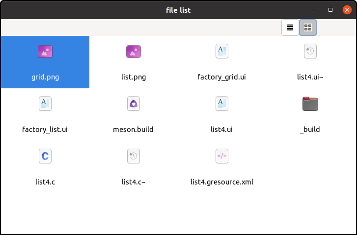
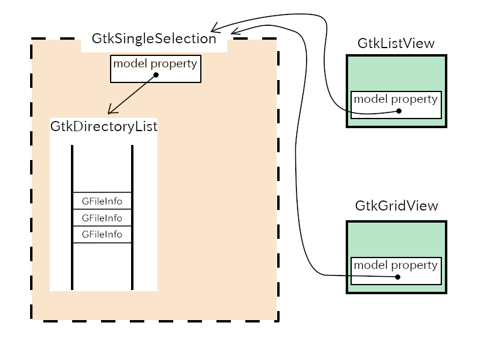
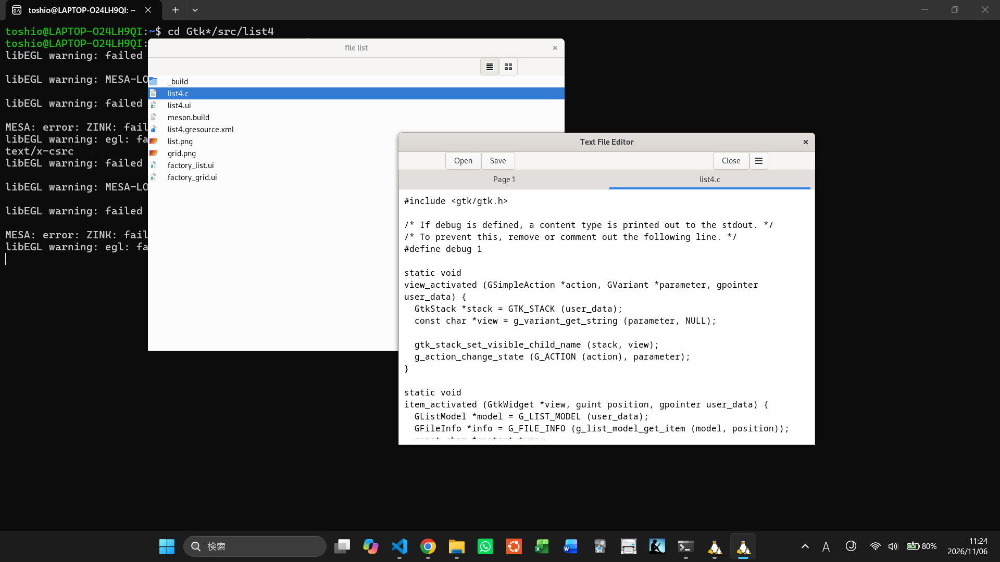

Up: [README.md](../README.md),  Prev: [Section 32](sec32.md), Next: [Section 34](sec34.md)

# GtkGridView and the Activate Signal

GtkGridView is similar to GtkListView, but presents items from a GListModel in a two-dimensional grid layout.



This layout is common in file managers such as GNOME Files (Nautilus).

In this section, we will build a simple file browser called `list4`.
It displays the files in the current directory, allowing users to switch between a list and a grid layout using the toolbar buttons.
Each item in the view shows an icon and its filename.
Furthermore, `list4` allows users to open a text file in the `tfe` text editor by either double-clicking an item or pressing Enter while it is selected.
This requires `tfe` to be pre-installed on your system.
Please refer to Section 26 for its installation.

## GtkDirectoryList

GtkDirectoryList is an implementation of GListModel that holds information about files in a specific directory.
Each item in the list is a GFileInfo object.

In the `list4` example (located in [src/list4](../src/list4/) directory), GtkDirectoryList is defined in a UI file (`list4.ui`) and built with GtkBuilder.
This GtkDirectoryList is then set to the "model" property of a GtkSingleSelection, which in turn is assigned to the "model" property of a GtkListView and GtkGridView.

```
GtkListView (model property) => GtkSingleSelection (model property) => GtkDirectoryList
GtkGridView (model property) => GtkSingleSelection (model property) => GtkDirectoryList
```



The following is part of the UI file `list4.ui`.

```xml
<object class="GtkListView" id="list">
  <property name="model">
    <object class="GtkSingleSelection" id="singleselection">
      <property name="model">
        <object class="GtkDirectoryList" id="directory_list">
          <property name="attributes">standard::name,standard::icon,standard::content-type</property>
        </object>
      </property>
    </object>
  </property>
</object>
・・・　・・・　・・・
・・・　・・・　・・・
<object class="GtkGridView" id="grid">
  <property name="model">singleselection</property>
</object>
```

GtkDirectoryList has an "attributes" property.
It specifies which GFileInfo attributes to retrieve, such as "standard::name", "standard::icon", and "standard::content-type".

- `standard::name`: The file name.
- `standard::icon`: An icon for the file (a GIcon object).
- `standard::content-type`: The MIME type of the file.

A content type (MIME type) indicates the format of a file and is used by the desktop system to handle files properly.
For example, "text/plain" represents a plain text file, and "text/x-csrc" represents C source code.
(Subtypes starting with "x-" like this are non-standard types not registered with IANA, but they are widely used in practice.)

## UI File for the Window

The application window is defined in the following UI file (`list4.ui`).
(Take a look at the screenshot at the beginning of this section to see how it looks.)

```xml
<?xml version="1.0" encoding="UTF-8"?>
<interface>
  <object class="GtkApplicationWindow" id="win">
    <property name="title">file list</property>
    <property name="default-width">800</property>
    <property name="default-height">600</property>
    <child>
      <object class="GtkBox">
        <property name="orientation">GTK_ORIENTATION_VERTICAL</property>
        <child>
          <object class="GtkBox">
            <property name="orientation">GTK_ORIENTATION_HORIZONTAL</property>
            <child>
              <object class="GtkLabel">
                <property name="hexpand">TRUE</property>
              </object>
            </child>
            <child>
              <object class="GtkToggleButton">
                <property name="action-name">win.view</property>
                <property name="action-target">&apos;list&apos;</property>
                <child>
                  <object class="GtkImage">
                    <property name="resource">/com/github/ToshioCP/list4/list.png</property>
                  </object>
                </child>
              </object>
            </child>
            <child>
              <object class="GtkToggleButton">
                <property name="action-name">win.view</property>
                <property name="action-target">&apos;grid&apos;</property>
                <child>
                  <object class="GtkImage">
                    <property name="resource">/com/github/ToshioCP/list4/grid.png</property>
                  </object>
                </child>
              </object>
            </child>
            <child>
              <object class="GtkLabel">
                <property name="width-chars">10</property>
              </object>
            </child>
          </object>
        </child>
        <child>
          <object class="GtkStack" id="stack">
            <property name="hexpand">TRUE</property>
            <property name="vexpand">TRUE</property>
            <child>
              <object class="GtkStackPage">
                <property name="name">list</property>
                <property name="child">
                  <object class="GtkScrolledWindow">
                    <property name="child">
                      <object class="GtkListView" id="list">
                        <property name="model">
                          <object class="GtkSingleSelection" id="singleselection">
                            <property name="model">
                              <object class="GtkDirectoryList" id="directory_list">
                                <property name="attributes">standard::name,standard::icon,standard::content-type</property>
                              </object>
                            </property>
                          </object>
                        </property>
                      </object>
                    </property>
                  </object>
                </property>
              </object>
            </child>
            <child>
              <object class="GtkStackPage">
                <property name="name">grid</property>
                <property name="child">
                  <object class="GtkScrolledWindow">
                    <property name="child">
                      <object class="GtkGridView" id="grid">
                        <property name="model">singleselection</property>
                      </object>
                    </property>
                  </object>
                </property>
              </object>
            </child>
          </object>
        </child>
      </object>
    </child>
  </object>
</interface>
```

Inside the top-level GtkApplicationWindow (lines 3–91), a vertical GtkBox divides the layout into two main parts.
The first part (lines 10–46) is a horizontal GtkBox that holds two toggle buttons for switching views.
The second part (lines 47–88) is a GtkStack that holds GtkListView and GtkGridView.

- 13-17, 40-44: Two empty GtkLabel widgets used as spacers to position the two buttons nicely toward the right.
- 18-39: Two GtkToggleButton widgets to switch between the list view and the grid view.
Both buttons are connected to a stateful action named `win.view`, which takes a parameter.
An action like this consists of a prefix, an action name, and a parameter (also called a target):
  - The prefix `win` defines the action's scope, indicating that it belongs to the top-level window (GtkApplicationWindow).
  - The action name is `view`.
  - The target is either `'list'` or `'grid'` (written as `&apos;list&apos;` and `&apos;grid&apos;` in the XML), which represents the new state the action will switch to.
We often write a detailed action with its target like `"win.view::list"` or `"win.view::grid"`.
- 20-21, 31-32: The `"action-name"` and `"action-target"` properties belong to the GtkActionable interface, which GtkToggleButton implements.
For the first button, the action name is `"win.view"` and the target is `'list'`.
In general, an action target is a GVariant value (such as a string, integer, or float), so you need to write it in GVariant text format in UI files.
For a string value, the `GVariant` text format requires single or double quotes around the text.
Because UI files are XML, single quotes must be escaped as `&apos;`.
Therefore, the target `'list'` is written as `&apos;list&apos;`.
Because the toggle buttons are connected directly to the action, you don't need to set up "clicked" signal handlers --- and their active (pressed) states are updated automatically to match the action's state.
- 22-26, 33-37: The child widget of each button is a GtkImage.
Its "resource" property specifies a GResource path.
GtkImage reads the image data from this resource to display a custom 24x24 PNG icon.
- 47-88: A GtkStack (`id="stack"`) containing two pages (GtkStackPage).
The first page (named "list") contains a GtkScrolledWindow with the GtkListView (`id="list"`), and the second page (named "grid") contains a GtkScrolledWindow with the GtkGridView (`id="grid"`).

## GtkStack

GtkStack is a container widget that holds multiple child widgets (called pages) and displays only one of them at a time.

It behaves much like `GtkNotebook`, except it does not have built-in tabs.
Instead, you control which page is visible using external widgets, such as the toggle buttons in our toolbar.
This makes GtkStack ideal for switching between different views in the same space --- like switching between GtkListView and GtkGridView in `list4`.

Inside a GtkStack, each child widget is wrapped in a GtkStackPage object:

```
GtkStack => GtkStackPage => Child Widget
```

As seen in lines 47–88 of `list4.ui` above, you add GtkStackPage objects to GtkStack and set two key properties on each page:

- **`name`**: A string identifier for the page (such as "list" or "grid").
- **`child`**: The widget to display on that page.

To switch to another page in C, you simply call `gtk_stack_set_visible_child_name ()` with the page's name.

- In `list4.c`, the visible page is explicitly set to "list" in the `app_activate` function (`gtk_stack_set_visible_child_name (stack, "list");`).
This ensures that the window shows the GtkListView instance initially.
- Afterwards, clicking a toggle button activates the "view" action and triggers its signal handler, `view_activated` (which receives the GtkStack instance as `user_data`).
This handler gets the target name ("list" or "grid") from the parameter, switches the visible page in the GtkStack, and updates the action's state so the toggle buttons reflect the current view.

```c
static void
view_activated (GSimpleAction *action, GVariant *parameter, gpointer user_data) {
  GtkStack *stack = GTK_STACK (user_data);
  const char *view = g_variant_get_string (parameter, NULL);

  gtk_stack_set_visible_child_name (stack, view);
  g_action_change_state (G_ACTION (action), parameter);
}
```

## Factories

Each view (GtkListView and GtkGridView) requires its own factory because they arrange their item widgets differently.
Both factories are GtkBuilderListItemFactory objects, defined by the following UI files:

factory_list.ui

```xml
<?xml version="1.0" encoding="UTF-8"?>
<interface>
  <template class="GtkListItem">
    <property name="child">
      <object class="GtkBox">
        <property name="orientation">GTK_ORIENTATION_HORIZONTAL</property>
        <property name="spacing">20</property>
        <child>
          <object class="GtkImage">
            <binding name="gicon">
              <closure type="GIcon" function="get_icon">
                <lookup name="item">GtkListItem</lookup>
              </closure>
            </binding>
          </object>
        </child>
        <child>
          <object class="GtkLabel">
            <property name="hexpand">TRUE</property>
            <property name="xalign">0</property>
            <binding name="label">
              <closure type="gchararray" function="get_file_name">
                <lookup name="item">GtkListItem</lookup>
              </closure>
            </binding>
          </object>
        </child>
      </object>
    </property>
  </template>
</interface>

```

factory_grid.ui

```xml
<?xml version="1.0" encoding="UTF-8"?>
<interface>
  <template class="GtkListItem">
    <property name="child">
      <object class="GtkBox">
        <property name="orientation">GTK_ORIENTATION_VERTICAL</property>
        <property name="spacing">20</property>
        <child>
          <object class="GtkImage">
            <property name="icon-size">GTK_ICON_SIZE_LARGE</property>
            <binding name="gicon">
              <closure type="GIcon" function="get_icon">
                <lookup name="item">GtkListItem</lookup>
              </closure>
            </binding>
          </object>
        </child>
        <child>
          <object class="GtkLabel">
            <property name="hexpand">TRUE</property>
            <property name="xalign">0.5</property>
            <binding name="label">
              <closure type="gchararray" function="get_file_name">
                <lookup name="item">GtkListItem</lookup>
              </closure>
            </binding>
          </object>
        </child>
      </object>
    </property>
  </template>
</interface>
```

The two files are almost the same.
The main differences are:

- The orientation of the GtkBox (horizontal for the list, vertical for the grid)
- The icon size (the grid explicitly sets icon-size to GTK_ICON_SIZE_LARGE)
- The text alignment of the GtkLabel (`xalign` is `0` for left-aligned in the list, and `0.5` for centered in the grid)

```
$ cd list4; diff factory_list.ui factory_grid.ui
6c6
<         <property name="orientation">GTK_ORIENTATION_HORIZONTAL</property>
---
>         <property name="orientation">GTK_ORIENTATION_VERTICAL</property>
9a10
>             <property name="icon-size">GTK_ICON_SIZE_LARGE</property>
20c21
<             <property name="xalign">0</property>
---
>             <property name="xalign">0.5</property>
32d32
< 
$
```

Notice the `<binding>` tags for the "gicon" (on GtkImage) and "label" (on GtkLabel) properties.
Because GFileInfo does not have direct properties for its icon and filename, the factory uses `<closure>` tags to extract this data using custom C functions.
The `get_icon` function retrieves a GIcon from the GFileInfo object, and the `get_file_name` function retrieves the filename string.

```c
GIcon *
get_icon (GtkListItem *item, GFileInfo *info) {
  GIcon *icon;

  /* g_file_info_get_icon can return NULL */
  icon = G_IS_FILE_INFO (info) ? g_file_info_get_icon (info) : NULL;
  return icon ? g_object_ref (icon) : NULL;
}

char *
get_file_name (GtkListItem *item, GFileInfo *info) {
  const char *name;

  name = G_IS_FILE_INFO (info) ? g_file_info_get_name (info) : NULL;
  return name ? g_filename_display_name (name) : g_strdup ("");
}
```

**A note on memory ownership:**

When using a closure binding, the caller (the factory) expects to own the return values.
This means your C functions must return new references or copies.
You will see in the C code that we use `g_object_ref ()` to keep the icon and `g_strdup ()` to copy the string, ensuring the memory ownership is transferred correctly.

## Content Type and Application Launch

When an item in the GtkListView or GtkGridView is double-clicked (or activated with the Enter key), the "activate" signal is emitted.
In `list4.c`, both views are connected to the same signal handler, `item_activated`, with `directory_list` passed as `user_data`.

`item_activated` retrieves the GFileInfo instance for the activated item and checks its content type (such as `"text/plain"` or `"text/x-csrc"`).
If the item is a text file, it launches `tfe` (our text file editor) to open the file.

```c
static void
item_activated (GtkWidget *view, guint position, gpointer user_data) {
  GListModel *model = G_LIST_MODEL (user_data);
  GFileInfo *info = G_FILE_INFO (g_list_model_get_item (model, position));
  const char *content_type;
  GAppInfo *appinfo;
  GFile *file;
  GList *files = NULL;
  GError *err = NULL;

  if (! info)
    return;
  content_type = g_file_info_get_content_type (info);
#ifdef debug
  g_print ("%s\n", content_type);
#endif
  if (content_type && g_str_has_prefix (content_type, "text/")) {
    appinfo = g_app_info_create_from_commandline ("tfe", "tfe", G_APP_INFO_CREATE_NONE, &err);
    if (err) {
      g_printerr ("%s\n", err->message);
      g_error_free (err);
    } else {
      file = g_file_new_for_path (g_file_info_get_name (info));
      files = g_list_append (files, file);
      if (! (g_app_info_launch (appinfo, files, NULL, &err))) {
        g_printerr ("%s\n", err->message);
        g_error_free (err);
      }
      g_list_free_full (files, g_object_unref);
      g_object_unref (appinfo);
    }
  }
  g_object_unref (info);
}
```

- 3–4: Retrieves the GListModel (`directory_list`) from `user_data` and gets the GFileInfo object at the activated `position`.
Because `g_list_model_get_item` returns a new reference to the item, we must free it with `g_object_unref (info)` at the end of the function (line 33).
- 13: Gets the content type of the file from the GFileInfo using `g_file_info_get_content_type`.
- 14–16: Prints the content type to standard output if `debug` is defined.
This is handy for checking the content types of various files.
If you don't need this output, remove or comment out `#define debug 1` at line 5 of `list4.c`.
- 17: Checks whether `content_type` is non-NULL and begins with `"text/"` using `g_str_has_prefix`.
Only text files proceed to launch `tfe`.
- 18: Creates a GAppInfo object for the `tfe` application.
GAppInfo is an interface that holds information about an application, and `appinfo` points to a GDesktopAppInfo instance.
- 23–24: Creates a GFile object from the file's name and appends it to a GList (`files`).
Note that `g_file_info_get_name ()` returns only the file's basename (e.g. "example.txt"), not its full path.
In `list4`, creating a GFile from this basename works because the GtkDirectoryList targets the current working directory (".").
- 25: Launches `tfe` with the file using `g_app_info_launch`.
This function takes four parameters:
  1. The GAppInfo object representing the application to launch.
  2. A GList of GFile objects to pass as arguments. Here we pass only one file, but you can pass multiple files in the list.
  3. A GAppLaunchContext (or `NULL` if not needed, as in this program).
  4. A pointer to a `GError *` for error reporting.
- 29–30: `g_list_free_full (files, g_object_unref)` frees both the GList and the GFile objects inside it.
Then `g_object_unref (appinfo)` frees the GAppInfo object.
- 33: Frees the GFileInfo reference obtained in line 4.

If your distribution supports GTK 4, using `g_app_info_launch_default_for_uri` is also very convenient.
This function asks the desktop environment to automatically determine the default application for a given file and launch it --- for example, opening a text file in the system's default text editor (such as GNOME Text Editor).

## Compilation and Execution

The source files are located in the [src/list4](../src/list4/) directory.
To compile and run `list4`, run the following commands:

```
$ cd list4 # or cd src/list4. It depends your current directory.
$ meson setup _build
$ ninja -C _build
$ _build/list4
```

When the application opens, the files are displayed in a list view.
Click the buttons in the toolbar to switch between the list view and the grid view.
If you double-click "list4.c" in the list (or the grid), the `tfe` text editor will launch and open the file.

Here is a screenshot of the running application:



## The "bytes" Property of GtkBuilderListItemFactory

GtkBuilderListItemFactory has a "bytes" property (of type GBytes) that holds a byte sequence of UI data.
By using this property, you can embed the contents of `factory_list.ui` and `factory_grid.ui` directly into the main UI file instead of keeping them as separate files.

Here is an excerpt from the combined UI file (`list5.ui`), located in the [src/list5](../src/list5/) directory:

```xml
  <object class="GtkListView" id="list">
    <property name="model">
      <object class="GtkSingleSelection" id="singleselection">
        <property name="model">
          <object class="GtkDirectoryList" id="directory_list">
            <property name="attributes">standard::name,standard::icon,standard::content-type</property>
          </object>
        </property>
      </object>
    </property>
    <property name="factory">
      <object class="GtkBuilderListItemFactory">
        <property name="bytes"><![CDATA[
<?xml version="1.0" encoding="UTF-8"?>
<interface>
  <template class="GtkListItem">
    <property name="child">
      <object class="GtkBox">
        <property name="orientation">GTK_ORIENTATION_HORIZONTAL</property>
        <property name="spacing">20</property>
        <child>
          <object class="GtkImage">
            <binding name="gicon">
              <closure type="GIcon" function="get_icon">
                <lookup name="item">GtkListItem</lookup>
              </closure>
            </binding>
          </object>
        </child>
        <child>
          <object class="GtkLabel">
            <property name="hexpand">TRUE</property>
            <property name="xalign">0</property>
            <binding name="label">
              <closure type="gchararray" function="get_file_name">
                <lookup name="item">GtkListItem</lookup>
              </closure>
            </binding>
          </object>
        </child>
      </object>
    </property>
  </template>
</interface>
        ]]></property>
      </object>
    </property>
  </object>
```

A CDATA section begins with `<![CDATA[` and ends with `]]>`.
Everything inside a CDATA section is treated as raw text.
Special XML syntax characters like `<` and `>` are recognized literally rather than as markup tags, so the XML text between `<![CDATA[` and `]]>` is passed directly to the "bytes" property as-is.

Because the factories are now defined inside `list5.ui` and assigned directly to the "factory" properties of the GtkListView and GtkGridView, `list5.c` no longer needs to create and set the factories in `app_activate`.

While this approach reduces the number of UI files, nesting XML inside XML makes the file harder to read, especially for beginners.
If you find it confusing, it is perfectly fine to keep the factory UI files separate as we did in `list4`.

Up: [README.md](../README.md),  Prev: [Section 32](sec32.md), Next: [Section 34](sec34.md)
