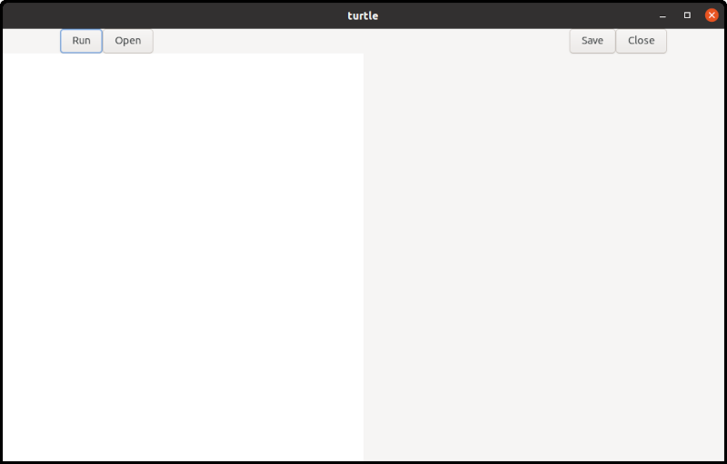
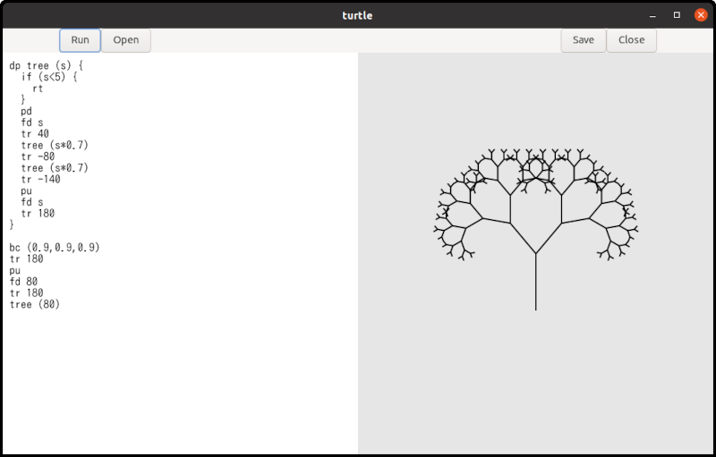
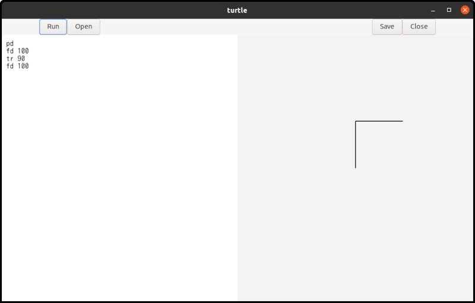
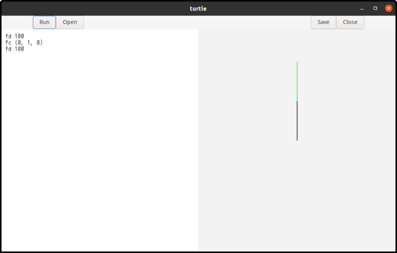
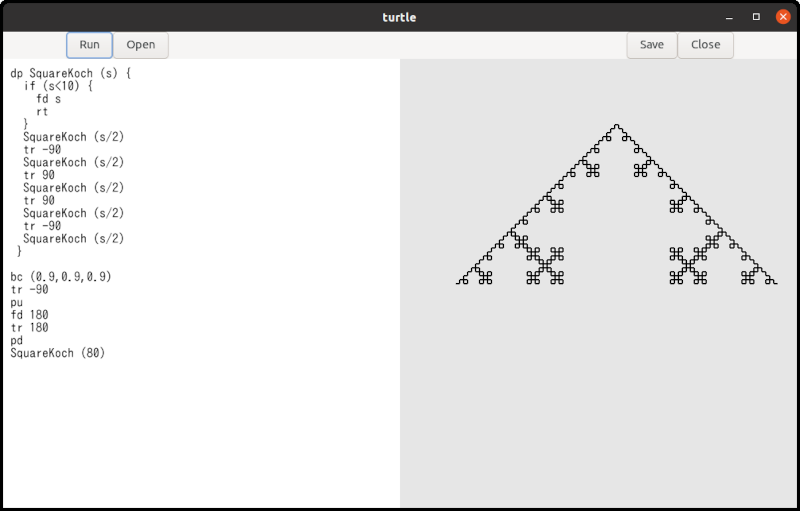

# Turtle Manual

Turtle is a simple interpreter for turtle graphics.

## Requirements and Installation

Turtle is written in C language.
You need:

- Linux. Turtle is tested on ubuntu 26.04 LTS
- gcc, meson and ninja
- gtk4. Turtle is tested on GTK 4.22.4

It is easy to compile Turtle's source files and install it.

For a user-area installation, put an option `--prefix=$HOME/.local` to your meson command line.
Then, it will be installed under `$HOME/.local/bin`.
The instruction is:

```
$ meson setup --prefix=$HOME/.local _build
$ ninja -C _build
$ ninja -C _build install
```

For a system-wide installation (under `/usr/local/bin`), just run it without any options.
You'll need root privileges for the install step, so don't forget to add 'sudo' to the last command.

```
$ meson setup _build
$ ninja -C _build
$ sudo ninja -C _build install
```

Type the following command, and the following window appears.

```
$ turtle
```



The left half is a text editor and the right half is a surface.
Surface is like a canvas to draw shapes.

Write Turtle language in the text editor and click the `run` button.
Then, the program will be executed and it draws shapes on the surface.



If you uncomment the following line in `turtle.y`, the codes for debugging will also be compiled.
Turtle shows the status to the standard output, but the speed is quite slow.
It is not recommended except you are developing the program.

```
/* # define debug 1 */
```

## Example

Imagine a turtle.
The turtle has a pen and initially it is at the center of the screen, facing to the north (to the north means up on the screen).
You can let the turtle down the pen or up the pen.
You can order the turtle to move forward.

```
pd
fd 100
```

- pd: Pen Down. The turtle put the pen down so that the turtle will draw a line if it moves.
- fd 100: ForwarD 100. The turtle goes forward 100 pixels.

If you click the `run` button, a line segment appears on the screen.
One of the endpoints of the line segment is at the center of the surface and the other is 100 pixels above the center.
The point at the center is the start position of the turtle and the other endpoint is its final position.

If the turtle picks the pen up, no line segment appears.

```
pu
fd 100
```

The command `pu` means "Pen Up".

The turtle can change its direction.

```
pd
fd 100
tr 90
fd 100
```

The command `tr` is "Turn Right".
The argument is an angle in degrees.
Therefore, `tr 90` means "Turn right by 90 degrees".
If you click the `run` button, two line segments appear.
One is vertical and the other is horizontal.



You can use `tl` (Turn Left) to change the turtle's direction as well.

## Background and Foreground Colors

Colors are specified using RGB and are represented by an (r, g, b) value.
Each component is a real number between 0 and 1.

- Red is (1.0, 0.0, 0.0).
You can also write (1, 0, 0).
- Green is (0.0, 1.0, 0.0)
- Blue is (0.0, 0.0, 1.0)
- Black is (0.0, 0.0, 0.0)
- White is (1.0, 1.0, 1.0)

You can create a variety of colors by changing the values of the three components.

There are two commands to change colors.

- bc: Background Color. `bc (1,0,0)` changes the background color to red.
This command clears the surface and changes its background color.
Any shapes on the surface disappear.
- fc: Foreground Color. `fc (0,1,0)` changes the foreground color to green.
This command changes the pen color.
Existing shapes on the surface are not affected.
After this command, the turtle draws lines in the new color.



## Other Commands

- pw: Pen Width. This is the same as pen size or line width.
For example, if the current line width is 3, `pw 5` makes newly drawn lines thicker, while `pw 1` makes them thinner.
- rs: ReSet. The turtle moves back to the initial position and direction.
In addition, The command initialize the pen, line width (pen size), and foreground color.
The pen is down, the line width is 2 and the foreground color is black.

An instruction such as `fd 100`or `pd` is called a statement.
Statements are executed in order, from the beginning to the end of the program.

## Comments and Spaces

Text following a `#` (hash mark) to the next `\n` (new line) is treated as a  comment.
It includes the beginning hash mark but doesn't include the new line.
If a comment appears on the last line of a file, the trailing new line can be omitted.
The program ignores all comments.

```
# draw a triangle<NEW LINE>
fd 100 # forward 100 pixels<NEW LINE>
tr 120 # turn right by 120 degrees<NEW LINE>
fd 100<NEW LINE>
tr 120<NEW LINE>
fd 100 # Now a triangle appears.<EOF>
```

Here, `<NEW LINE>` and `<EOF>` represent a newline character and the end of te file respectively.
The comments on lines 1, 2, 3 and 6 are all syntactically correct.

Whitespace characters (spaces, tabs and newlines) are ignored and serve only as delimiters between commands and values.
When calculating column numbers, each tab is treated as eight spaces.

## Variables and Expressions

Variable names begin with a letter, followed by any comnibnation of letters and digits.
Keywords like `fd` or `tr` can't be used as variable names.
`Distance` and `angle5` are variables, but `1step` is not, because it starts with a number instead of a letter.

Variable names are case-sensitive.

All variables store real numbers and function identically to the `double` type in C language.
Integers are automatically cast to real numbers, meaning 1 and 1.0 represent the same value.

When writing numeric numbers, they must begin with a digit rather than a sign (`+` or `-`).

- `100`, `20.34` and `0.01` are valid numbers
- `+100` is not a valid number and will cause a syntax error. You should simply use `100` instead.
- `-100` is technically not a single number. However, turtle recognizes the `-` as a unary minus operaor and applies it to the number `100`,
so the calculated result is still `-100`.
- `100 + -20` is a valid expression and will be recognized as `100 + (- 20)` since unary minus has higher precedence than addition.
However, using parentheses --- written as `100 + (-20)` --- is recommended to make your code easier to read.

```
distance = 100
fd distance
```

In the first line, the value `100` is assigned to the variable `distance`.
An assignment is a type of statement.
While most statements must begin with a command like `fd`, assignments are the only exception to this rule.

The example above draws a line segment 100 pixels long.

You can use variables in expressions.
There are 8 types of operations available.

- Addition: `x + y`
- Subtraction: `x - y`
- Multiplication: `x * y`
- Division: `x / y`
- Unary minus: `- x`
- Logical equality: `x == y`
- Greater than: `x > y`
- Less than: `x < y`

The last three operators are primarily used as conditions in `if` statements.

A variable is registered in the symbol table the first time it is assigned a value.
Evaluating a variable before it has been registered is not allowed and will cause an error.

## The if Statement

The Turtle language has a very simple `if` statement.

```
if (x > 50) {
  fd x
}
```

There is no else clause.

## The loop Statement

The Turtle language has a very simple loop construct: `rp` (RePeat) statement.

```
rp (4) {
  fd 100
  tr 90
}
```

The code repeats the statements enclosed the curly braces four times.

## Procedures

Procedures are similar to functions in the C language.
The main difference is that procedures do not return a value.

```
dp triangle (side) {
  fd side
  tr 120
  fd side
  tr 120
  fd side
  tr 120
}

triangle (100)
```

The `dp` (Define Procedure) keyword is followed by a procedure name, a list of parameters, and the procedure's body.
Procedure names must begin with a letter, followed by letters or digits.
Parameters are provided as a comma-separated list of variables inside parentheses.

For example:

```
dp abc (a) { ... ... }
dp abc (a, b) { ... ... }
dp abc (a, b, c) { ... ... }
```

The body is a sequence of statements.
These statements are not executed when the procedure is defined.
Instead, they are executed later when the procedure is called.

Procedures are called by their names followed by arguments.

```
dp proc (a, b, c) { ... ... }

proc (100, 0, -20*3)
```

The number of arguments must match the number of parameters.
An argument can be any valid expression.
When calling a procedure, you must include parentheses after the procedure name,even if there are no arguments.

Procedure names and variable names do not conflict.

```
dp a () {fd a}
a=100
a ()
```

This is a valid program.

- 1: Defines a procedure name `a`.
A variable name `a` is used in its body.
- 2: Assigns the value `100` to the variable `a`.
- 3: Calls the Procedure `a`.

However, using the same name for a procedure and a variable causes confusion.
You should avoid doing this.

## Recursive Calls

Procedures can be called recursively.

```
dp repeat (n) {
  n = n - 1
  if (n < 0) {
    rt
  }
  fd 100
  tr 90
  repeat (n)
}

repeat (4)
```

In this example, `repeat` is called from within its own body.
A procedure calling itself is known as a recursive call.

New parameters are created and set each time the procedure is called.
Therefore, the parameter `n` is 4 during the first call, but it is 3 during the second call.
Each time the procedure is called, `n` decreases by one.
Finally, when `n` becomes less than zero, the procedure returns.

Notice that the condition uses `< 0` rather than `== 0`.
Because all numbers in the Turtle language are floating-point values (`double`), they are subject to tiny precision errors (rounding errors) during calculations.
Checking for exact equality with `==` might fail due to these microscopic errors, which would cause an infinite loop.
Using `<` ensures the recursion terminates safely.

The program above draws a square.
This demonstrates that we can program loops using recursive calls.

## Fractal Curves

A fractal is a special pattern that looks exactly the same even as you zoom in.
To draw one, you start with a basic shape and apply a simple rule repeatedly.
With every step, you add a smaller version of the shape, scaling it down at a constant rate (like exactly half the size of the previous one).


This shape is called a fractal tree, or simply 'tree'.
The base pattern is a single line segment, which represents the first stage.
In the second stage, two shorter line segments are added to the endpoint of the original segment.
Each new segment is 70% of the original length and is rotated by +30 or -30 degrees.
The third stage applies this same rule, adding two even shorter segments to the ends of the second-stage segments.
This process is then repeated several times to generate the complete tree.

This repetition is implemented using recursive calls.
Two additional examples are shown below: the Koch curve and the Square Koch curve.




The `src/turtle/example` folder contains some example Turtle code including the shapes above.

## Tokens and Punctuation

Below is a list of the available tokens.

Keywords:

- `pu`: Pen up
- `pd`: Pen down
- `pw`: Pen width (line width)
- `fd`: Forward
- `tr`: Turn right
- `tl`: Turn left
- `bc`: Background color
- `fc`: Foreground color
- `if`: If statement
- `rt`: Return
- `rs`: Reset
- `rp`: Repeat
- `dp`: Define procedure

Identifiers and Numbers:

- Identifier: Used for the names of variables, parameters and procedures.
It is denoted by the regular expression `[a-zA-Z][a-zA-Z0-9]*`.
- Number: Defined by the expression `(0|[1-9][0-9]*)(\.[0-9]+)?`.
Numbers do not include a `+` or `-` sign to avoind syntactic ambiguity.
However, a negative value such as `-10` is evaluated as a unary minus operator followed by a number.

Assignment:

- `=`: Assignment

Expression Symbols:

- `==`: Equality
- `>`: Greater than
- `<`: Less than
- `+`: Addition
- `-`: Subtraction or Unary Minus
- `*`: Multiplication
- `/`: Division
- `(`: Left parenthesis (Opening parenthesis)
- `)`: Right parenthesis (Closing parenthesis)

Delimiters:

- `(`: Left parenthesis (used to open parameter and argument lists, as well as conditions or values for statements such as `if`, `rp`, `bc`, and `fc`)
- `)`: Right parenthesis (used to close parameter and argument lists, as well as conditions or values for statements such as `if`, `rp`, `bc`, and `fc`)
- `{`: Left curly brace (used to open a block of statements, such as a procedure body)
- `}`: Right curly brace (used to close a block of statements)
- `,`: Comma (used to separate parameters or arguments)

Comments and Whitespace:

- Comment: A comment begins with a `#` symbol and continues until the next newline character.
If a comment is placed at the very end of a file, the trailing newline may be omitted.
- Space: The standard space character.
- Horizontal tab: Recognized as eight spaces.
- Newline: Marks the end of a line.

Comments and whitespace are used to explicitly separate tokens.
They do not have any syntactic meaning and are ignored by the parser.

## Grammar

```
program:
  statement
| program statement
;

statement:
  primary_procedure
| procedure_definition
;

primary_procedure:
  pu
| pd
| pw expression
| fd expression
| tr expression
| tl expression
| bc '(' expression ',' expression ',' expression ')'
| fc '(' expression ',' expression ',' expression ')'
| ID '=' expression    /* ID is an identifier which is a name of variable */
| if '(' expression ')' '{' primary_procedure_list '}'
| rt
| rs
| rp '(' expression ')' '{' primary_procedure_list '}'
| ID '(' ')'    /* ID is an identifier which is a name of procedure */
| ID '(' argument_list ')'    /* the same as above */
;

procedure_definition:
  dp ID '('  ')' '{' primary_procedure_list '}'
| dp ID '(' parameter_list ')' '{' primary_procedure_list '}'
;

parameter_list:
  ID
| parameter_list ',' ID
;

argument_list:
  expression
| argument_list ',' expression
;

primary_procedure_list:
  primary_procedure
| primary_procedure_list primary_procedure
;

expression:
  expression '==' expression
| expression '>' expression
| expression '<' expression
| expression '+' expression
| expression '-' expression
| expression '*' expression
| expression '/' expression
| '-' expression %prec UMINUS
| '(' expression ')'
| ID
| NUM    /* NUM is a number */
;
```
